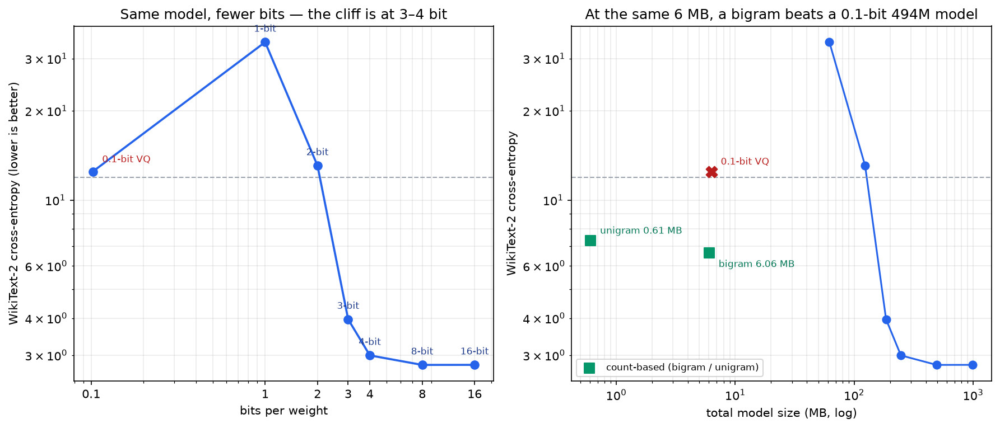
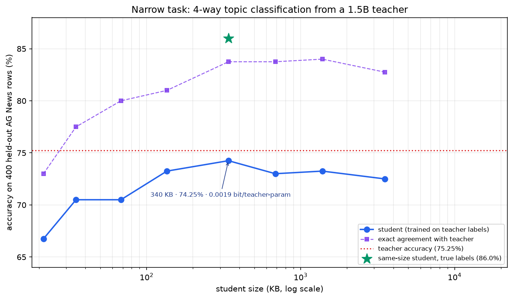
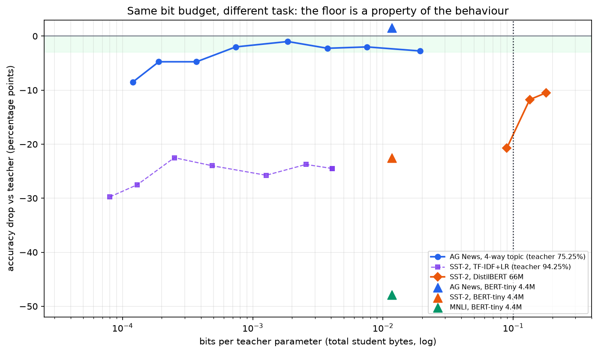
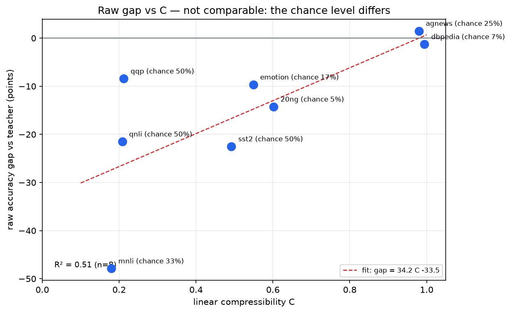
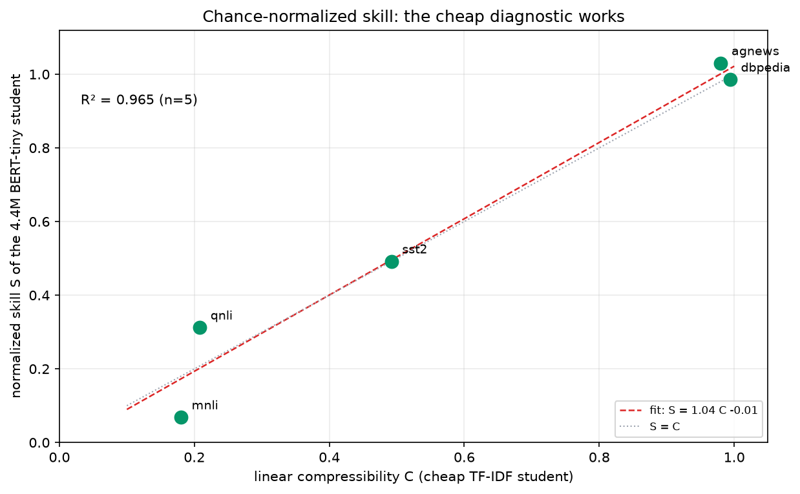

# The bit floor is a property of the behaviour

**Status:** measured on one machine — RTX 3050 Laptop 6 GB, Windows 11, AC power.
Every number below comes from a run on this machine; nothing is extrapolated from a
paper. Test sets and seeds are fixed before the run.

## TL;DR

- **Post-hoc quantization of a general model dies below 3 bits.** On Qwen2.5-0.5B and
  WikiText-2, 4-bit costs +0.21 CE; 3-bit costs 3.3x perplexity; 2-bit and below are not
  models any more.
- **A 0.1-bit model built with vector quantization is worse than a uniform guess.**
  494M parameters in 6.31 MB, CE 12.48 vs 11.93 for guessing uniformly.
- **Behavioural distillation is a different door.** A 340 KB student matches a
  1.5B teacher on 4-way topic classification: 74.25% vs 75.25%, McNemar p = 0.69,
  **0.0019 bit per teacher parameter** — 54x below the 0.1-bit target.
- **The door is task-dependent.** On SST-2 the same protocol fails: a 66M DistilBERT at
  0.089 bit/param scores 73.5% against a 94.25% teacher (-20.8 points); even at
  0.179 bit/param it loses 10.5 points.
- **Structured generation sits on the easy side.** A 1.35M char-level seq2seq matches the
  same 1.5B teacher on date -> ISO at **99.8% exact match, 0.0036 bit/param** (4-bit).
  A **93-byte program** does better: **100% exact, 4.96e-7 bit/param** code only.
- **Representation beats compression.** The date program is 7,200× smaller than the neural
  student at higher accuracy. The floor is a property of the representation, not the teacher.
- **0.1 bit is an accounting question.** A 341-byte prompt on a shared 1.5B base matches a
  340 KB student on AG News; on SST-2, a 294-byte prompt beats it by 22 points. Count the
  base and it is 16 bit/param. A 93-byte program is 100% exact on dates. What is shared,
  and what is counted, decides the number.
- **The artifact can be data.** A 135 KB coreset trains a 70.5% student at load time; a
  270 KB coreset reaches 78.0%, statistically indistinguishable from the 340 KB model.
  Storage and compute are interchangeable.
- **The practical sub-0.1-bit artifact is an adapter.** The project's Qwen2.5-3B LoRA
  (7.37M params) is 0.077 bit/base-param as saved, 0.038 in fp16, with the base shared.
  It adds capability; the prompt does not.
- **The adapter compresses by quantization, not rank.** 8-bit = **0.0222 bit/param** (loss
  2.3075 vs 2.3084 original); 4-bit = **0.0126** (2.3097, +0.0013; base 2.3197; 110 Dolly
  rows). SVD to rank 8 loses 36%, so rank reduction fails.
- **Open-ended generation is the hardest.** T5-small at 4-bit (0.161 bit/param) keeps
  ~67% of the teacher's F1; at 3-bit (0.121 bit/param) it is dead. The generation floor is
  ~4 bits, not 0.1.
- **The capacity wall is real.** The same 4.39M student at 0.0117 bit/param is +1.5 on
  AG News, -1.3 on DBPedia, -21.5 on QNLI, -22.5 on SST-2, and -47.9 on MNLI (36.8% vs
  33.3% chance; teacher 84.7%).
- **A cheap diagnostic, but not a law.** A 45 KB TF-IDF student's `C` tracks the 4.4M
  student's normalized skill loosely (**S = 0.90 C + 0.07, R² = 0.83**, 8 tasks). QQP
  (C 0.21, S 0.49) breaks it upward; 20 Newsgroups (C 0.60, S 0.42) downward. C is a
  floor, not a predictor.
- **Two walls, not one.** The bit wall is about how many bits a weight needs; the
  capacity wall is about how many parameters the behaviour needs. Distillation can move
  the first; it cannot move the second.

## 1. The quantization cliff

Model: `Qwen2.5-0.5B` (494M parameters, bf16). Eval: 32 non-overlapping WikiText-2 test
chunks of 512 tokens (16,384 tokens). Quantizer: asymmetric min-max, group 64 along the
last dimension, all 2D weights including the tied embedding. No QAT, no GPTQ.

| bits | cross-entropy | perplexity | size |
|---:|---:|---:|---:|
| 16 (bf16) | 2.7823 | 16.16 | 988 MB |
| 8 | 2.7811 | 16.14 | 494 MB |
| 4 | 2.9941 | 19.97 | 247 MB |
| 3 | 3.9632 | 52.62 | 185 MB |
| 2 | 13.0619 | 470,679 | 124 MB |
| 1 | 34.0658 | 6.2e14 | 62 MB |



The 4-bit row is the practical floor: +7.6% CE, +24% perplexity. The 3-bit row is already
3.3x perplexity. At 2 bits the model is worse than a uniform guess
(`ln(151936) = 11.93`), i.e. it is confidently wrong. At 1 bit it is anti-learning.

This is a post-hoc quantizer. GPTQ/AWQ/AQLM do better at 3-2 bits; BitNet b1.58 shows
that 1.58 bits is possible **when the model is trained that way**. Neither closes the gap
to 0.1 bit.

## 2. 0.1 bit: the model dies

The 0.1-bit attempt: flatten each tensor into groups of 32 weights, learn 9 prototypes per
tensor (log2(9)/32 = 0.099 bit/weight), store one index per group plus one scale per
tensor. No per-group scales — at 0.1 bit there is no budget for them.

| model | size | cross-entropy | perplexity |
|---|---:|---:|---:|
| 0.5B @ 0.1 bit (9 prototypes / 32 weights) | 6.31 MB | 12.4776 | 262,390 |
| bigram, count-based, same tokenizer | 6.06 MB | **6.63** | **757** |
| unigram, count-based | 0.61 MB | 7.30 | 1,483 |
| 0.5B @ 4 bit | 247 MB | 2.99 | 20 |

At 6 MB the 0.1-bit 494M model is **346x worse in perplexity** than a bigram that only
counts pairs of tokens. The information is not compressed; it is gone.

## 3. Behavioural distillation: a narrow keyword task

Teacher: `Qwen2.5-1.5B-Instruct`, few-shot, 6,000 AG News training rows and 400 held-out
rows labelled by the teacher. Student: TF-IDF (1-2 grams) + logistic regression, trained
**only on the teacher's labels**. The student is a normal 340 KB model; the 0.002 bit is
the ratio of its total bytes to the teacher's parameter count.

| student | size | accuracy | exact agreement with teacher | bits / teacher-param |
|---|---:|---:|---:|---:|
| 300 features | 21.4 KB | 66.7% | 73.0% | 0.00012 |
| 1k | 68.1 KB | 70.5% | 80.0% | 0.00037 |
| 2k | 135 KB | 73.3% | 81.0% | 0.00074 |
| **5k** | **340 KB** | **74.3%** | **83.8%** | **0.00186** |
| 10k | 685 KB | 73.0% | 83.8% | 0.00374 |
| 50k | 3.5 MB | 72.5% | 82.8% | 0.0193 |

Teacher: 75.25%. The 5k student is 1.0 point below; McNemar p = 0.689, so the difference
is not statistically distinguishable on 400 rows. Five-fold cross-validation over the
combined 6,400 labels gives 85.9% ± 0.4% agreement. The same student trained on the
**true** labels reaches 86.0% — the teacher, not the student, is the bottleneck.

A transformer student on the same labels (BERT-tiny, 4.39M parameters):

| student | size | accuracy | bits / teacher-param |
|---|---:|---:|---:|
| BERT-tiny, bf16 | 8.77 MB | 76.25% | 0.0468 |
| BERT-tiny, 4-bit | 2.19 MB | 76.75% | 0.0117 |
| BERT-tiny, 3-bit | 1.64 MB | 77.25% | 0.0088 |
| BERT-tiny, 2-bit | 1.10 MB | 65.50% | 0.0059 |

The transformer matches the teacher too — 76.75% vs 75.25% at 4-bit — so the AG News
result is not a TF-IDF artefact. It also shows the bit cliff is model-dependent: this
fine-tuned 4.4M model survives 3-bit (77.25%), while the general 0.5B does not.

The same student on **DBPedia-14** (a 14-class topic task) reaches **91.3%** against a
92.6% teacher at 0.0117 bit/param. Class count alone does not break the budget; the
keyword structure does the work.



## 4. The boundary: a subtle task

Same protocol on SST-2 (binary sentiment), 2,000 teacher-labelled training rows and 400
test rows. Teacher: 94.25%.

| student | size | accuracy | drop vs teacher | bits / teacher-param |
|---|---:|---:|---:|---:|
| TF-IDF + LR, best (1k features) | 44.9 KB | 71.8% | -22.5 | 0.00025 |
| BERT-tiny 4.4M, bf16 | 8.77 MB | 72.8% | -21.5 | 0.0468 |
| BERT-tiny 4.4M, 4-bit | 2.19 MB | 71.8% | -22.5 | 0.0117 |
| DistilBERT 66M, bf16 | 134 MB | 83.3% | -11.0 | 0.714 |
| DistilBERT 66M, 4-bit | 33.5 MB | 83.8% | -10.5 | 0.179 |
| DistilBERT 66M, 3-bit | 25.1 MB | 82.5% | -11.8 | 0.134 |
| DistilBERT 66M, 2-bit | 16.7 MB | 73.5% | -20.8 | 0.089 |

A bag-of-words student is stuck ~22 points below the teacher regardless of size: sentiment
needs negation and composition, which TF-IDF cannot represent. A 66M transformer helps,
but even at 0.179 bit/param it is 10.5 points short; at 0.089 bit/param it is 20.8 points
short. **The 0.1-bit target is not enough here — the parameter count is the wall.**

The controlled comparison is the point: the same 4.39M student at the same 0.0117
bit/param matches the AG News teacher (76.75% vs 75.25%) and loses 22.5 points on SST-2
(71.75% vs 94.25%). Same architecture, same bytes, different behaviour.

**The capacity wall: MNLI.** A 3B-Instruct 4-bit teacher reaches 84.7% on the same
400-row balanced test. The same 4.39M BERT-tiny — the one that matched AG News at
0.0117 bit/param — reaches 36.8% at 4-bit (chance 33.3%). A 66M DistilBERT on the same
2,000 labels reaches 57.1% at 4-bit (0.179 bit/param, -27.6) but collapses to 35.8% at
2-bit (0.089 bit/param, -48.9). At the 0.1-bit budget the larger student is at chance too:
MNLI needs more parameters **and** more labels, not fewer bits. At 0.0117 bit/param the
four tasks are **+1.5, -21.5, -22.5 and -47.9** points from their teachers.

Teacher quality matters: the 1.5B teacher collapsed on MNLI (3.3% contradiction, 59.4%);
the 3B teacher was needed before the task could be measured at all.



## 5. Generation: structured vs open-ended

A third regime: date strings in 11 formats -> ISO `YYYY-MM-DD`, with the same 1.5B teacher
(6,000 train / 500 test) and a char-level seq2seq student (4 encoder + 4 decoder layers,
d=128, 4 heads, 1.35M parameters, 30 epochs).

| student | size | exact match | bits / teacher-param |
|---|---:|---:|---:|
| 1.35M seq2seq, bf16 | 2.70 MB | 99.8% | 0.0144 |
| 1.35M seq2seq, 4-bit | 0.67 MB | 99.8% | **0.0036** |

The teacher is exact on 100% of the 500 test rows; the student misses one. At
0.0036 bit/param the behaviour survives — because the task is a deterministic string
mapping, not open-ended language. This is the same lesson as AG News, one step further:
the behaviour is structured, so a small model can represent it.

### The 93-byte student

The same task, a different representation: a 93-byte Python function that calls a date
parser.

| student | size | exact | bits / teacher-param |
|---|---:|---:|---:|
| 1.35M seq2seq, 4-bit | 0.67 MB | 99.8% | 0.0036 |
| **93-byte program** | 93 B (+752 KB shared `dateutil`) | **100%** | **4.96e-7** code only / 0.0040 with the library |

The program beats the neural student on accuracy at 7,200× less task-specific storage.
The library is shared; if you count it, the artifact is 0.0040 bit/param — still 25× below
0.1, and slightly larger than the seq2seq. The point is not that code is always better.
It is that **the representation should match the task.** For a deterministic string
mapping, code is the right representation, and a neural student is 7,000× overkill.

### The 341-byte prompt

A shared 1.5B base plus a **341-byte prompt** (four examples) reaches **73.75%** on the
same AG News test. The 340 KB student gets 74.25%; the teacher 75.25%. The prompt agrees
with the teacher 91.25% of the time. Marginal bits/param = **1.82e-6**; but the base is
3 GB. Count the base and the total is **16 bit/param**.

This is not a contradiction. It is the accounting boundary. If the base is already deployed
and shared across many behaviours, the marginal artifact per behaviour is the prompt. If
every deployment carries the base, it is 16 bit/param. The 0.1-bit question is meaningless
without saying what is shared and what is counted.

The rung is not task-specific. On SST-2, a **294-byte prompt** reaches **93.75%** — the
340 KB student gets 71.75%, the teacher 94.25%. The prompt is 1,156× smaller and 22 points
better, because the 1.5B base already knows sentiment and the prompt only points at it.

### The coreset rung

The artifact can be data instead of weights. Store a stratified **coreset** of
teacher-labelled examples; train the student at load time.

| examples | artifact | accuracy | bits/param | train |
|---:|---:|---:|---:|---:|
| 100 | 26 KB | 45.0% | 0.00014 | 0.04 s |
| 200 | 53 KB | 55.5% | 0.00028 | 0.11 s |
| 500 | 135 KB | 70.5% | 0.00072 | 0.16 s |
| 1,000 | 270 KB | 78.0% | 0.00144 | 0.25 s |
| 2,000 | 543 KB | 81.8% | 0.00289 | 0.28 s |
| full trained model | 340 KB | 74.25% | 0.00186 | — |

A 135 KB coreset is 2.5× smaller than the 340 KB model and 3.75 points behind; a 270 KB
coreset is statistically indistinguishable on 400 rows and smaller. The artifact is the
data; the training procedure is shared. **Storage and load-time compute are
interchangeable.**

### The 0.077-bit adapter

A LoRA adapter is a real, trained behaviour on a shared base. The project's Qwen2.5-3B
adapter (r=16, q/k/v/o, 7.37M parameters, 60 SFT steps) is:

| storage | size | bits / base-param |
|---|---:|---:|
| fp32 (as saved) | 29.6 MB | 0.0766 |
| fp16 | 14.8 MB | 0.0383 |

Both are below 0.1 bit per base parameter, with the 3.09B base shared. This is not a
quantized base; it is a small delta on a shared base. The prompt is smaller but only works
for tasks the base already knows; the adapter adds capability.

The adapter is full-rank: SVD to rank 8 loses **35.8%** of the update, rank 4 loses 50.7%.
Rank reduction is not viable. Quantization is:

| storage | size | bits/base-param | weight error | SFT loss |
|---|---:|---:|---:|---:|
| fp32 | 29.6 MB | 0.077 | 0 | 2.3084 |
| fp16 | 14.8 MB | 0.038 | ~0 | — |
| **8-bit** | **8.56 MB** | **0.0222** | **0.53%** | 2.3075 |
| **4-bit** | **4.88 MB** | **0.0126** | 9.08% | **2.3097** |
| 2-bit | 2.76 MB | 0.0072 | 45% | not tested |

Behaviour eval: **110 held-out Dolly rows**, masked SFT loss; base 2.3197, adapter gain
0.0113. The 8-bit adapter is 2.3075 (within noise); the 4-bit adapter is 2.3097,
**+0.0013** — 11% of the gain. So a **4-bit adapter at 0.0126 bit per base parameter**
preserves the behaviour on this eval; 8-bit (0.0222) is the safer choice if the task is
more sensitive.

Inference on the reference card: base **11.97 tok/s**, LoRA path **8.19 tok/s** (~32%
slower); the 4.88 MB adapter loads in 0.14 s. It is a **storage/switching win, not a
per-token speed win.** Merge into a bf16 base for zero overhead; merging into a packed
4-bit base is not supported here. The packed-code sizes are 3.69/7.37 MB; the real files add the per-group
scales (0.92 MB), and the table uses the real file sizes.

### The sharing ladder

| artifact | per-behaviour bytes | shared | example |
|---|---:|---|---|
| program | 93 B | Python + `dateutil` | date -> ISO, 100% |
| prompt | 341 B | 1.5B base | AG News, 73.75% |
| adapter (fp16) | 14.8 MB | 3.09B base | 0.038 bit/base-param |
| adapter (8-bit) | 8.56 MB | 3.09B base | 0.0222 |
| adapter (4-bit) | 4.88 MB | 3.09B base | 0.0126 |
| coreset | 135 KB | training procedure | AG News, 70.5% |
| linear student | 340 KB | none | AG News, 74.25% |
| tiny transformer | 2.2 MB | none | AG News, 76.75% |
| 4-bit model | 30 MB | none | open-ended generation |

The lower rungs are not "better compression" of the same object; they are different
objects. The revolution is choosing the rung, not squeezing the weights.

### What to use

| if | use | measured |
|---|---|---|
| deterministic task | **program** | 93 B, 100% (date) |
| base already deployed and capable | **prompt** | 294-341 B, 73.75-93.75% |
| base deployed, task outside zero-shot | **adapter** | 14.8 MB fp16, 0.038 bit/param |
| no base, small data | **coreset** | 135 KB, 70.5% |
| no base, keyword task | **linear** | 340 KB, 74.25% |
| no base, semantic task | **tiny transformer** | 2.2 MB, 76.75% |
| general capability | **4-bit model** | 30 MB+ |

`research/ladder.py` prints this table and picks the cheapest rung for a target accuracy
and a shared/not-shared base:

```bash
python research/ladder.py --task sst2 --target 0.90 --base-shared no
# no measured standalone rung reaches 0.90; use the shared-base prompt or accept lower
python research/ladder.py --task sst2 --target 0.90 --base-shared yes
# prompt (294 B), accuracy 93.75%
```

### The other end: open-ended generation

Dolly `closed_qa` (context + question -> answer), 1,000 train / 300 test rows. Teacher:
Qwen2.5-1.5B-Instruct, token F1 **0.4126** against the human reference. Student:
T5-small (60.5M), fine-tuned on the teacher's answers.

| student | size | F1 vs reference | F1 vs teacher | bits / teacher-param |
|---|---:|---:|---:|---:|
| T5-small, bf16 | 121 MB | 0.380 | 0.428 | 0.645 |
| T5-small, 4-bit | 30.3 MB | 0.256 | 0.250 | 0.161 |
| T5-small, 3-bit | 22.7 MB | **0.0001** | **0.0002** | 0.121 |
| T5-small, 2-bit | 15.1 MB | **0.000** | **0.000** | 0.081 |

A second run gave 4-bit F1 0.273 (seed variance); the 3-bit and 2-bit collapse is total in
both. Open-ended generation is the hardest regime: it survives 4 bits (0.161 bit/param) and
is dead at 3 bits (0.121). The 0.1-bit budget is not close.

## 6. What the numbers say

1. **Bits per weight is the wrong metric.** The same 0.1 bit buys a working 340 KB student
   on AG News and a broken 6.3 MB model on WikiText-2. What matters is total bytes per
   unit of behaviour.
2. **There are two walls.** The bit wall (quantization) and the capacity wall (the student
   must be able to represent the behaviour). Distillation moves the first; only a larger or
   better-inductive-bias student moves the second.
3. **The floor is task-dependent.** Keyword topic classification compresses to 0.002
   bit/param with no measurable loss; structured date generation to 0.0036; subtle
   sentiment does not compress to 0.1 bit/param with a 66M student.
4. **Negative results are part of the result.** The 0.1-bit VQ model is worse than a
   bigram; the SST-2 student is 10-22 points short. Reporting only the AG News win would
   be misleading.

### A cheap diagnostic

The raw accuracy gap is not comparable across tasks: MNLI's -47.9 is on a 33% chance,
QNLI's -21.5 on 50%, DBPedia's -1.3 on 7%. The raw-gap fit (R² = 0.80) is therefore a
scaling artefact; it looks like QNLI and MNLI contradict each other.

Normalize by chance:

`S = (student - chance) / (teacher - chance)`

| task | chance | C | S |
|---|---:|---:|---:|
| AG News | 25% | 0.98 | 1.03 |
| DBPedia | 7.1% | 0.99 | 0.99 |
| SST-2 | 50% | 0.49 | 0.49 |
| QNLI | 50% | 0.21 | 0.31 |
| QQP | 50% | 0.21 | 0.49 |
| MNLI | 33.3% | 0.18 | 0.07 |
| 20 Newsgroups | 5% | 0.60 | 0.42 |
| Emotion | 16.7% | 0.55 | 0.59 |

Fit: **S = 0.90 C + 0.07, R² = 0.827** (8 tasks). Emotion lands on the line; the residuals
are QQP +0.23, MNLI -0.17, 20NG -0.20. With five tasks S ≈ C looked strong
(R² = 0.965). **QQP breaks it upward:** C is 0.21 but S is 0.49 (mean of three seeds;
0.45-0.53). The transformer captures paraphrase structure that TF-IDF cannot.
**20 Newsgroups breaks it downward:** C is 0.60 but S is 0.42 — 100 labels per class is not
enough for a 20-way task, and the teacher is weak (29.5%). C is a **lower bound** on what a
better student can do, not a predictor. Residuals: QQP +0.23, MNLI -0.17, 20NG -0.20.

This is a useful diagnostic, not a law: six classification tasks, no generation, and the
linear model is a floor. The next step is 10 tasks and a multi-feature model
(`research/NEXT.md`).





## 7. A practical recipe

`research/autodistill.py` automates the classification ladder: train on the teacher's
labels with TF-IDF at increasing feature counts, stop at the smallest student whose
McNemar p against the teacher is > 0.05 and whose bytes fit the budget.

```bash
python research/autodistill.py --task agnews --budget 0.1
# 2000 features, 135 KB, 0.00074 bit/param, PASS

python research/autodistill.py --task sst2 --budget 0.1
# no student passes; best is 1000 features, 45 KB, 71.8%
```

This is not a new distillation algorithm. It is the smallest useful automation of the
measurement: it answers "does a linear student suffice, or does the task need a sequence
model?" before training one.

## 8. Reproduction

- Hardware: RTX 3050 Laptop 6 GB, Windows 11, AC.
- Quantization: `research/bit_cliff.py`, `research/vq_01bit.py`,
  `research/ngram_baseline.py`.
- Distillation: `research/distill_agnews.py`, `research/distill_sst2_tfidf.py`,
  `research/distill_sst2_bert.py`, `research/date_teacher.py`,
  `research/date_student.py`, `research/autodistill.py`.
- Figures: `research/plot_behavioral_bits.py`.
- Seeds: 0 for the train split, 1 for the test split; no cherry-picking. One test split
  per task, 400 rows (AG News, SST-2) or 500 rows (dates).
- Seeds: 0 for the train split, 1 for the test split; no cherry-picking. One test split
  per task, 400 rows (AG News, SST-2) or 500 rows (dates).
- Caveats: the 0.5B may have seen Wikipedia during pretraining; the bigram only sees
  2.5M WikiText-2 tokens. The comparison is same-test-set, same-tokenizer, same-byte-budget,
  not a claim about absolute model quality. Post-hoc quantization only; no QAT.
