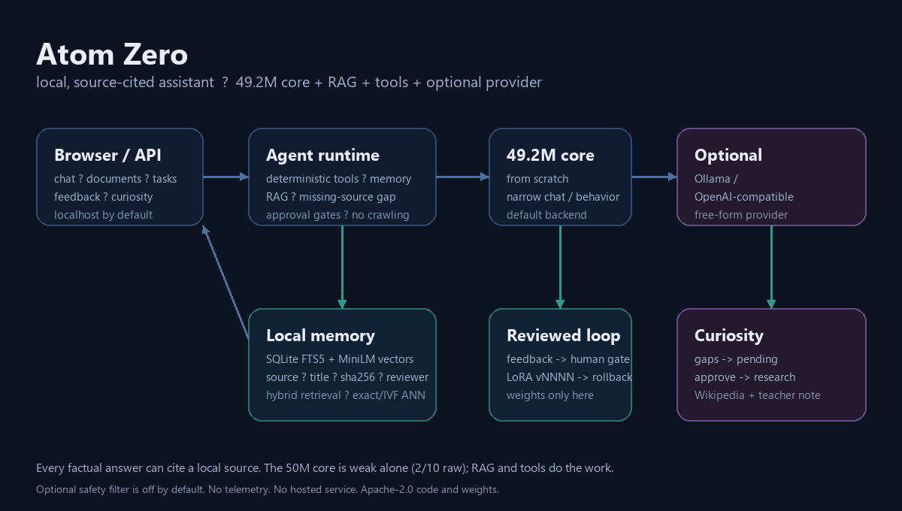

# Atom Zero: A 49M Local Assistant That Says “I Don’t Know”

**Subtitle:** Why I put facts in RAG instead of the model weights — and what 392 tests taught me about small local AI.

*This is not a ChatGPT competitor. It is a deliberately small, local assistant with source citations, deterministic tools, and an approval gate for research.*

---

Most local AI demos start with a bigger model. I went the other way: a **49.2M parameter language model trained from scratch**, wrapped in a runtime that does the things a small model is bad at.

That decision came from a simple observation: a 50M model is not going to win a general-knowledge contest. Pretending otherwise is how tiny-model demos lose trust. So I stopped asking the weights to store facts.

Instead:

- the model handles short wording and behavior;
- SQLite + hybrid retrieval supplies facts and citations;
- deterministic tools handle arithmetic, time, tasks and memory;
- a reviewed LoRA path handles style and skills, not facts.

The result is a local assistant that can answer from my own documents, show the source, and say “I don’t have a source for that yet” when it genuinely doesn’t know.



*Architecture: the 49.2M core is the default backend; RAG, tools and memory are local; a provider is optional.*

## The honest benchmark

This is the part I wish more small-model projects published.

| check | result |
|---|---:|
| raw 49.2M, no RAG/tools | **2/10** |
| product with RAG/tools | **21/21** |
| behavior checks | **16/16** |
| source-cited retrieval top-1 | **1.000** (FTS 0.850) |
| test suite | **392 passed** |

The raw-model probe asks ten simple general questions with no documents, no calculator and no agent. The 49.2M model gets **2/10**. The product gets **21/21** because the runtime does the work.

The product benchmark is narrow and authored: tools, memory, tasks, source-cited retrieval, teacher-note review, missing-source detection and one short generation. It is **not MMLU, GSM8K or HumanEval**. I am not claiming the 49M model is generally intelligent.

On the clean scaled validation shard, the trained checkpoint does improve language-model fit:

- chat bpb: **1.5032 → 1.3815**
- assistant loss: **4.2153 → 3.8551**

But the raw knowledge probe stays at **2/10**. Training the behavior model did not turn it into a knowledge base. That is why facts belong in RAG.

## Why the adapter doesn’t magically add facts

I also tested the reviewed LoRA adapter path:

- raw 49.2M + adapter: **2/10**
- product + adapter: **21/21**
- behavior: **16/16**

The adapter is useful for style and narrow skills. It is not a fact database. If you want the model to know a new policy, a paper or a project detail, put it in the document index.

There is a second reason: the adapter path is **gated**. A feedback example must be reviewed, exported, trained, checked against target loss, clean bpb/assistant regression, behavior and smoke tests, then activated explicitly. The model never mutates its own weights while you chat.

## Curiosity, with a human gate

The feature I am most careful about is the **curiosity queue**.

When no local source answers a question, it becomes a knowledge gap. The assistant can propose pending gaps as research topics:

```text
question -> no local source -> knowledge gap
gap -> pending curiosity topic
human approves
worker fetches Wikipedia context
local Ollama teacher synthesizes
answer stored as an unverified teacher note in RAG
next answer can cite it; weights_changed: false
```

That is retrieval-memory learning, not gradient learning. A live run produced:

```text
before:          I do not have a source for that yet...
unapproved_run:  0 item(s)
approved_run:    done
after:           ... Wellington ... (teacher note, unverified)
weights_changed: false
```

No autonomous crawling. No self-directed weight mutation. The human approves the topic, and the answer remains unverified until a reviewer marks it verified.

## What makes it different?

It is not a smaller version of a frontier chatbot. The differences are architectural:

- **Source-cited RAG first:** hybrid FTS + MiniLM retrieval, top-1 1.000 on the authored held-out set.
- **Honest missing-source behavior:** no source means no invented answer.
- **Local privacy:** SQLite and JSON on disk, no telemetry, exact source/session deletion.
- **Deterministic tools:** arithmetic, time, tasks, name/likes memory.
- **Reviewed adapters:** human approval, holdout evidence, versioning and rollback.
- **Optional provider:** plug in a local Ollama/OpenAI-compatible model for free-form chat while RAG and tools stay local.
- **No hosted service:** this is a local tool, not a cloud product.

The closest description is: a compact **agent harness** with a small language model inside. The harness is the reusable asset.

## Try it

```powershell
pip install streamft==0.8.1
git clone https://github.com/byjameson/stream-finetune.git
cd stream-finetune
powershell -ExecutionPolicy Bypass -File scripts/quickstart_atomzero.ps1
```

The quickstart seeds a small demo corpus (launch code, warranty, travel, visitor badge), starts the server and opens the browser. Try:

```text
What is the launch code?                         -> cited local answer
What is the population of Paris?                 -> no source; gap recorded
Propose curiosity topics                         -> pending, approval required
Add task buy milk / My name is Alex              -> local tools + memory
```

Optional stronger local chat:

```powershell
powershell -ExecutionPolicy Bypass -File scripts/quickstart_atomzero.ps1 -WithProvider
```

That routes free-form chat to local Ollama `llama3.2:3b` while RAG, tools and memory remain local. It is not the default backend.

## What it is not

- Not a general reasoning or coding model.
- Not a ChatGPT competitor.
- Not a hosted service.
- Not a system that silently crawls, trains on your data or changes its own weights.
- Not a claim that 49M parameters are enough for general intelligence.

## What is next

The honest gaps are model capability, tool planning, multilingual quality and a larger evaluation set. The current escape hatch is the optional local provider. Training a larger model is a separate compute/data decision, not a prompt tweak.

If you want to inspect the claims:

- GitHub: https://github.com/byjameson/stream-finetune
- PyPI: https://pypi.org/project/streamft/0.8.1/
- Hugging Face: https://huggingface.co/byjameson/atom-zero-49m
- ModelScope: https://modelscope.cn/models/byjameson/atom-zero-49m
- Model card: https://github.com/byjameson/stream-finetune/blob/main/docs/MODEL_CARD.md
- Benchmarks: https://github.com/byjameson/stream-finetune/blob/main/docs/BENCHMARKS.md
- Original dev.to post: https://dev.to/mycute_97b39c4e34027570f9/atom-zero-a-49m-local-assistant-that-says-i-dont-know-1p7m

Apache-2.0 for code and weights. Built on a 6 GB RTX 3050 laptop.

---

*If you build local RAG or small-model agents, I would like to hear what breaks first. The most useful feedback is a failing question with a source and an expected answer.*
