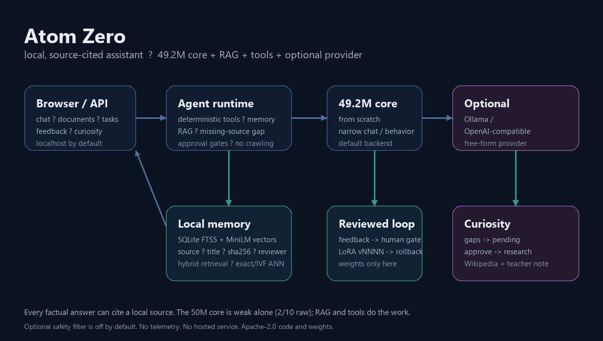

# Atom Zero 49.2M model card

Version: model weights `0.8.0`; standalone `atomzero 0.1.1` or `streamft 0.9.2`<br>
Last updated: 2026-11-22
License: Apache-2.0 for code and weights; data attribution in `NOTICE`.



## Full system context

This model card covers the weights. The **full project map** — runtime, RAG,
tools, memory, research, curiosity, self-learning, provider, safety, privacy,
benchmarks and release — is
[`PROJECT_OVERVIEW.md`](https://github.com/byjameson/stream-finetune/blob/main/docs/PROJECT_OVERVIEW.md).

## System features

| area | implemented |
|---|---|
| core model | 49.2M decoder-only transformer, BPE-8k, 6 layers, 768 dim, 128 context |
| training | 175.37M clean + 214.8M replay; 40k product checkpoint |
| RAG | SQLite FTS5, hashed/MiniLM embeddings, hybrid candidates, lexical+cosine rerank |
| vector index | cached `doc_vectors`, prewarmed numpy matrix, IVF ANN above 256 chunks, exact fallback |
| tools | time, safe arithmetic, task add/list/complete, name/likes memory, allowlisted 3-step plan API with confirmation |
| sessions | transcript restore, JSON export/import, exact Forget, session Forget |
| documents | ingest text/Markdown/HTML/PDF/DOCX, page/section citations, evidence panel/API, source/title/sha256, search, per-source delete |
| research | approved-only queue, Wikipedia fetch, worker lock/log, teacher synthesis |
| teacher | local Ollama/OpenAI-compatible, unverified notes, reviewer verification |
| curiosity | gap -> pending topic -> approval -> Wikipedia + teacher -> RAG note |
| self-learning | RAG memory (no weights), reviewed LoRA (weights), manual full training |
| provider | optional local free-form chat, RAG/tools stay local, `--allow-general-chat` |
| safety | optional rules + local linear ML head; off by default; exact fallback |
| privacy | localhost, no telemetry, SSRF guard, upload caps, deletion |
| UI | chat, documents, gaps, research queue, teacher notes, adapters, health |
| packaging | standalone `atomzero` package (assistant deps only) plus `streamft` trainer (full deps), `atomzero` entry point, GitHub release, HF/ModelScope weights |
| tests | 412 passed; product 21/21; behavior 16/16; retrieval 1.000 |
| document benchmark | 100 authored questions: 80/80 answerable, 20/20 no-answer |

## Model

| item | value |
|---|---|
| name | Atom Zero 49.2M (`transformer_behavior_50m_scaled`) |
| architecture | decoder-only transformer |
| parameters | 49,213,440 |
| layers / dim / heads / FF | 6 / 768 / 12 / 3072 |
| context | 128 tokens |
| tokenizer | 8,192-token BPE (`data/chat_en_bpe8k.json`) |
| checkpoint step | 40,000 |
| training tokens | 175.37M clean + replay mix to 214.8M |
| runtime | PyTorch, CUDA or CPU; RTX 3050 6 GB tested |

The model is trained from scratch. It is a **narrow chat/behavior model**, not
a foundation model. Facts are expected to live in RAG; skills can live in
reviewed LoRA adapters.

## Intended use

- Local, single-user daily assistant: short chat, tasks, notes, arithmetic,
  time, and source-cited document lookup.
- English-first; RAG and tools do most of the factual work.
- Optional local provider backend for free-form chat with a user-supplied
  larger model.

## Out of scope

- General reasoning, coding, mathematics beyond simple arithmetic.
- Medical, legal, financial or safety-critical advice.
- Autonomous web crawling, weight mutation or unsupervised tool use.
- Multi-tenant or hosted operation without additional controls.
- Claims of MMLU/GSM8K/HumanEval or frontier-model parity.

## Benchmarks: raw vs learned/augmented

"Learned" below means the trained product checkpoint and reviewed adapter.
"Augmented" means the runtime adds RAG, retrieval and deterministic tools. The
raw-model probe uses no RAG, no tools and no agent.

| variant | raw knowledge | product | behavior | notes |
|---|---:|---:|---:|---|
| base 49.2M | 2/10 | 21/21 | 16/16 | no RAG/tools |
| product 49.2M (40k) | 2/10 | 21/21 | 16/16 | scaled corpus |
| + adapter `v0001` | 2/10 | 21/21 | 16/16 | adapter does not add facts |
| + RAG/tools | — | 21/21 | 16/16 | source-cited answers |
| + hybrid neural retrieval | — | 21/21 | 16/16 | retrieval top-1 **1.000** vs FTS 0.850 |
| + optional ML safety | — | 26/26 | 16/16 | filter off by default |

Language-model fit on the clean scaled validation shard:

| metric | base | product 40k |
|---|---:|---:|
| chat bpb | 1.5032 | **1.3815** |
| assistant loss | 4.2153 | **3.8551** |
| stories bpb | 1.622 | **1.4144** |
| mixed bpb | — | **1.2406** |
| wiki bpb | — | **2.1746** |

The raw-model probe is **2/10** for both base and product. That is the honest
reason for the architecture: put facts in RAG, not in 50M weights.

## Teacher -> RAG "learning" demo

`research/teacher_learning_demo.py` asks a question with no local source, asks
the local Ollama teacher, stores the answer as an **unverified teacher note**,
and asks again:

```text
before:  I do not have a source for that yet...
teacher: The capital of New Zealand is Wellington.
after:   I found these notes:
         - ... Wellington. (teacher note, unverified: teacher://ollama/...)
weights_changed: false
```

This is retrieval-memory learning, not gradient learning. The model does not
open Ollama by itself or decide what to study; a user/queue explicitly asks the
teacher, and the note remains unverified until a reviewer marks it.

## Why it is different

- **49M local core**, not a 7B+ general model; the harness is the product.
- **Source-cited RAG first**: hybrid FTS + MiniLM retrieval, top-1 1.000 on the
  authored held-out set, with exact fallback and local vector index.
- **Deterministic tools and personal memory** rather than free-form tool
  planning.
- **Reviewed adapters** with gates, holdout and rollback; no unreviewed weight
  mutation.
- **Local privacy**: SQLite, no telemetry, exact source/session deletion,
  export/import.
- **Optional local provider** for users who want a stronger model without
  changing the core.
- **No hosted service** and no claim of general intelligence.

## Limitations

- 2/10 raw knowledge; weak general reasoning and coding.
- English-first tokenizer/data.
- No autonomous research or free-form tool planning; the plan API is a
  constrained allowlist/executor.
- Product benchmark is narrow and authored; it is not MMLU.
- Adapter evidence is small-sample; it improves target loss, not general skill.
- Long-context work is still limited by the 128-token core context.

## Reproduce

```bash
python research/benchmark_raw.py \
  --model checkpoints/transformer_behavior_50m_scaled \
  --out research/results/raw_knowledge_scaled_40k.json

python research/benchmark_assistant.py \
  --model checkpoints/transformer_behavior_50m_scaled \
  --out research/results/assistant_benchmark_scaled_40k_provider.json

python research/benchmark_retrieval.py \
  --vector-index ann \
  --out research/results/retrieval_benchmark_ann.json

python research/behavior_eval.py \
  --model checkpoints/transformer_behavior_50m_scaled \
  --out research/results/behavior_scaled_40k_provider.json
```

Evidence lives in `research/results/` and
[`BENCHMARKS.md`](https://github.com/byjameson/stream-finetune/blob/main/docs/BENCHMARKS.md).

## Published artifacts

- GitHub release: <https://github.com/byjameson/stream-finetune/releases/tag/v0.9.2>
- Atom Zero PyPI: <https://pypi.org/project/atomzero/0.1.1/>
- streamft PyPI: <https://pypi.org/project/streamft/0.9.2/>
- Hugging Face: <https://huggingface.co/byjameson/atom-zero-49m>
- ModelScope: <https://modelscope.cn/models/byjameson/atom-zero-49m>
- launch article: <https://dev.to/mycute_97b39c4e34027570f9/atom-zero-a-49m-local-assistant-that-says-i-dont-know-1p7m>
- Medium: <https://medium.com/@myredditacc9393/atom-zero-a-49m-local-assistant-that-says-i-dont-know-df1ebc0e2e78>
- document formats: [`DOCUMENTS.md`](https://github.com/byjameson/stream-finetune/blob/main/docs/DOCUMENTS.md)

## Contact

- Email: **gokhancava@gmail.com**
- LinkedIn: <https://www.linkedin.com/in/g%C3%B6khan-cava-874a32157/>
- GitHub issues: <https://github.com/byjameson/stream-finetune/issues>
