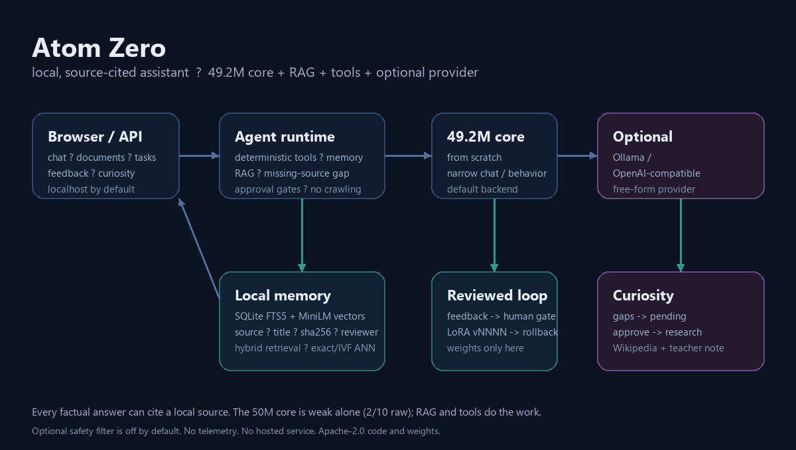

# Atom Zero — full project map

This is the complete, honest description of the project: the model, the
runtime, retrieval, tools, memory, research, self-learning, safety, privacy,
benchmarks, packaging and limits. It is the canonical long-form overview;
shorter pages link here.

## 1. One-paragraph summary

Atom Zero is a **local, source-cited assistant** built around a **49.2M-parameter
transformer trained from scratch**. The model is deliberately small: it handles
short wording and behavior, while SQLite retrieval supplies facts, deterministic
tools handle arithmetic/time/tasks/memory, and a reviewed adapter path handles
style and skills. Unanswered questions become knowledge gaps; a human approves
curiosity topics; a local Ollama teacher can turn approved sources into
**unverified RAG notes**. The model never crawls or mutates its own weights on
its own. Apache-2.0 code and weights, no hosted service, no telemetry.

## 2. What it is — and what it is not

**It is:**

- a local assistant for a small GPU or CPU;
- a source-cited RAG system over your own text, Markdown, HTML, PDF and DOCX
  documents, with page/section locators;
- a deterministic tool/memory runtime;
- a reviewed research + curiosity loop;
- a small-model + harness reference implementation;
- optionally, a front-end for a stronger local provider.

**It is not:**

- a general reasoning or coding model;
- a ChatGPT/Claude competitor;
- a model that stores all facts in its weights;
- an autonomous crawler or self-modifying agent;
- a hosted multi-tenant service;
- a claim that 49.2M parameters are enough for general intelligence.

## 3. Architecture



| layer | implementation | what it does |
|---|---|---|
| UI/API | `packages/atomzero/src/atomzero/chat_server.py` | browser chat, documents, evidence panel, constrained plan API, tasks, gaps, queues, teacher notes, adapters, health |
| agent runtime | `packages/atomzero/src/atomzero/agent_runtime.py`, `research/chat_human.py` | tool routing, memory, RAG, missing-source path |
| core model | `packages/atomzero/src/atomzero/transformer.py` + checkpoint | 49.2M decoder-only transformer |
| retrieval | `packages/atomzero/src/atomzero/doc_memory.py`, `neural_embedder.py` | FTS5 + hashed/MiniLM vectors + reranking |
| memory | SQLite + session JSON | documents, provenance, facts, tasks, episodes |
| research | `packages/atomzero/src/atomzero/research_queue.py`, `research/research_worker.py` | approved Wikipedia fetch + teacher synthesis |
| curiosity | `packages/atomzero/src/atomzero/curiosity.py` | gaps -> pending research, approval required |
| learning | `research/learning_loop.py`, LoRA | reviewed feedback -> gated adapter -> rollback |
| provider | `packages/atomzero/src/atomzero/teacher_provider.py`, `--chat-provider-*` | optional local OpenAI-compatible chat |
| safety | `packages/atomzero/src/atomzero/safety.py`, `ml_safety.py` | optional rules + local linear ML head |

## 4. Model and training

| item | value |
|---|---|
| parameters | 49,213,440 |
| architecture | decoder-only transformer |
| layers / dim / heads / FF | 6 / 768 / 12 / 3072 |
| context | 128 tokens |
| tokenizer | 8,192-token BPE (`data/chat_en_bpe8k.json`) |
| checkpoint step | 40,000 |
| clean train tokens | 175.37M |
| replay mix | 214.8M tokens |
| clean valid tokens | 3.21M |

The 40k checkpoint is the product checkpoint
(`checkpoints/transformer_behavior_50m_scaled`). A lower-LR resume to 48k did
not materially beat it (best 44k: chat bpb 1.3800 / assistant 3.8497 vs 40k
1.3815 / 3.8551), so 40k remains the product.

Clean scaled-valid fit:

| metric | base | product 40k |
|---|---:|---:|
| chat bpb | 1.5032 | **1.3815** |
| assistant loss | 4.2153 | **3.8551** |
| stories bpb | 1.622 | **1.4144** |
| mixed bpb | — | **1.2406** |
| wiki bpb | — | **2.1746** |

The raw knowledge probe stays at **2/10**. Training improves behavior and
language-model fit; it does not turn a 49M model into a fact database.

## 5. Runtime and deterministic tools

The agent routes explicit commands without asking the model to choose tools:

- time;
- arithmetic/calculator (safe AST evaluation);
- task add/list/complete;
- name and likes memory;
- document search and source-cited answers;
- explicit `research` / `look up`;
- help/limits.

This is intentionally conservative. It is reliable and easy to audit, but it is
not free-form tool planning. A separate `POST /v1/agent/plan` endpoint executes
a caller-supplied JSON plan through an allowlist: at most 3 steps, no shell or
arbitrary URL, and explicit `confirm: true` before task/research side effects.
The 49M model does not choose those steps. See [`TOOL_PLANNING.md`](TOOL_PLANNING.md).

## 6. Retrieval (RAG)

The document index stores chunk, source, title, sha256, timestamp and
provenance metadata (teacher, model, verified, reviewer, verified_at). A
separate `doc_chunk_meta` table keeps `page` (PDF), `section`
(DOCX/HTML/Markdown) and character offsets for each chunk. Extraction is local:
`pypdf` for PDF, `python-docx` for DOCX, a stdlib HTML parser for HTML, and a
heading-aware Markdown reader. Scanned PDFs are rejected with a clear OCR
message; there is no hidden conversion service.

Pipeline:

1. SQLite FTS5 returns lexical candidates.
2. Chunk embeddings are cached in `doc_vectors`.
3. The best FTS rows are merged with an embedding candidate pool.
4. A reranker scores coverage, title match, exact phrase, bm25 and cosine.
5. The top snippets are quoted with `source`, `title`, sha256 and, when
   available, `page` or `section`.

Two reranker paths:

- **hashed character n-grams** — deterministic, dependency-free fallback;
- **local MiniLM-L6-v2** (`models/all-MiniLM-L6-v2`) — optional neural
  embeddings, mean pooling, cosine.

The neural candidate stage uses a hybrid FTS + neural pool. The exact authored
retrieval benchmark reaches **top-1/citation 1.000** versus **0.850** for raw
FTS; FTS candidate recall@10 is 0.900, hybrid recall@10 is 1.000. Median
retrieval latency is about **8.8 ms** on the authored set.

The prewarmed vector index is a numpy matrix over cached chunks. At 3000 chunks
it is **166x** faster than the old SQLite-blob scan (0.77 ms vs 127.6 ms) with
identical top-5. Above 256 chunks, auto mode builds a deterministic k-means IVF
ANN index; 20k-vector benchmark: **0.64 ms vs 3.22 ms exact (5x)** at recall@10
1.000, with an exact fallback on low confidence/errors/short results. This is
IVF, not HNSW. Writes invalidate the index; the next search rebuilds it.

## 7. Sessions, memory and UI

- Browser session ID persists in `localStorage`; New session is explicit.
- Session JSON stores facts, tasks and recent episodes.
- `/v1/memory/history` restores the visible transcript.
- `/v1/memory/export` / `import` moves a session as JSON; exports contain
  personal data.
- Exact source `Forget` and session `Forget` paths, with path-separator
  handling and SQLite `VACUUM`.
- UI exposes documents/search, knowledge gaps, research queue, curiosity,
  teacher notes/provider, adapter versions/health.
- No telemetry.

## 8. Research, teacher and curiosity

The research queue is reviewed:

```text
pending -> approved -> running -> done/error/rejected
```

Only approved topics are fetched. The worker has a lock, stale-running
recovery, JSONL log and daily Windows task. A local Ollama teacher
(`llama3.2:3b`) can synthesize fetched Wikipedia context into an **unverified
teacher note**; Wikipedia works if Ollama is down. Teacher notes start
unverified and can be verified with a reviewer + timestamp.

Curiosity is gap-driven, not autonomous:

```text
question -> no local source -> knowledge gap
gap -> pending curiosity topic
human approves
worker fetches Wikipedia
local teacher synthesizes an unverified RAG note
next answer cites it; weights_changed: false
```

`POST /v1/curiosity/propose` or the browser’s **Propose curiosity topics**
creates up to three pending research items. No fetching or teacher call happens
before approval. Live evidence: `research/results/curiosity_live.json`
(`unapproved_run: 0`, `approved_run: done`, `weights_changed: false`).

## 9. Self-learning: three levels

| level | what changes | approval | weights change? |
|---|---|---|---|
| RAG memory | document/teacher note enters index | human/queue | no |
| Reviewed adapter | LoRA style/skill adapter | human + gate | yes |
| Full training | new base checkpoint | offline decision | yes, manual |

The only runtime weight-update path is the reviewed adapter:

```text
feedback -> human approve/reject -> export approved JSONL
-> LoRA train -> gate: target gain + clean bpb/assistant + behavior + smoke
-> accepted vNNNN -> explicit activate/rollback -> --adapter auto
```

Adapters are a style/skill layer, not a fact database: raw probe stays 2/10
with the adapter. Curiosity/teacher notes do not train weights. The model does
not decide what to study or self-modify.

## 10. Optional local provider

The server can route free-form chat to any OpenAI-compatible endpoint:

```powershell
python -m atomzero.chat_server `
  --model checkpoints/transformer_behavior_50m_scaled `
  --docs data/docs.db `
  --chat-provider-url http://127.0.0.1:11434/v1 `
  --chat-provider-model llama3.2:3b `
  --allow-general-chat
```

RAG, tools and memory stay local. Source-grounded questions still use local
notes; with `--allow-general-chat`, unsourced questions go to the provider and
report no sources. The provider is text-only: it does not plan or execute tools.
A local URL keeps prompts on the machine; a remote URL does not. The default
remains the 49.2M model.

## 11. Safety (optional)

The safety filter is **off by default** and is an operator tool, not a content
policy or moral position.

- Exact rule layer: English regex + language-agnostic lexical-semantic rules
  for TR/DE/ES/FR/IT/PT/NL/RU.
- Optional local ML head: MiniLM embeddings + linear harm/category classifier
  (`packages/atomzero/src/atomzero/moderation_head.json`, ~58 KB), trained on 349 generated examples
  with authored holdouts excluded.
- Rules run first and are authoritative; ML only adds blocks. A missing/broken
  head/model returns exact rules.
- Input threshold 0.495; output threshold 0.90 to avoid assistant-reply false
  positives.
- Red-team: 72/72 filter, output 4/4, agent 72/72; benign false blocks 0/26;
  held-out semantic paraphrases 10/10 (rules only 1/10). ML-only on the authored
  72-case set is 61.1%; hybrid is 100%.
- `--no-safety-ml` forces the rule baseline.

This is a small local linear head, not a full moderation model. Hosts decide
whether to enable it.

## 12. Privacy and security

- Local bind `127.0.0.1` by default; optional API key.
- No telemetry, no hosted service.
- SSRF guard; URL fetch is opt-in; upload size caps.
- Exact source/session deletion and SQLite `VACUUM`.
- Prompt-injection suite 4/4: retrieved text is data, cannot execute tools, add
  tasks, spoof citations or disable safety.
- Document/teacher metadata keeps provenance and review state.
- Chat provider is opt-in; remote URLs leave the machine.

## 13. Benchmarks (honest scope)

| check | result |
|---|---:|
| raw 49.2M, no RAG/tools | **2/10** |
| product with RAG/tools | **21/21** |
| behavior checks | **16/16** |
| source-cited retrieval top-1 | **1.000** (FTS 0.850) |
| document benchmark (100 authored questions) | **80/80 answerable, 20/20 no-answer** |
| safety-enabled product | **26/26** |
| test suite | **412 passed** |

The product benchmark is narrow and authored: tools, memory, tasks, retrieval,
teacher-note review, missing-source detection and one short generation. It is
not MMLU, GSM8K or HumanEval. The 21/21 is the product, not the bare model.

## 14. Packaging and reproduction

```powershell
pip install atomzero==0.1.5
atomzero-quickstart
```

`atomzero 0.1.5` is the standalone assistant package. `streamft 1.0` is the
separate low-VRAM trainer; `streamft 0.9.2` is the last compatibility release
that bundled Atom Zero. The quickstart downloads the checkpoint/tokenizer from
Hugging Face, seeds a demo corpus, starts the server and opens the browser.
`--provider` enables local Ollama. Both packages are on PyPI; the 49.2M
checkpoint is not bundled in either wheel.

Reference machine: RTX 3050 Laptop 6 GB, 34 GB RAM, Windows 11. The core also
runs on CPU, slower.

## 15. Released artifacts and contact

Atom Zero canonical surfaces: GitHub, Hugging Face, PyPI, dev.to and Medium.
ModelScope and LinkedIn are no longer maintained release channels.

- GitHub (trainer monorepo): https://github.com/byjameson/stream-finetune
- GitHub (Atom Zero): https://github.com/byjameson/atom-zero
- Releases (trainer): https://github.com/byjameson/stream-finetune/releases
- Atom Zero releases: https://github.com/byjameson/atom-zero/releases
- streamft PyPI (trainer): https://pypi.org/project/streamft/
- atomzero PyPI (standalone assistant): https://pypi.org/project/atomzero/
- Hugging Face: https://huggingface.co/byjameson/atom-zero-49m
- dev.to: https://dev.to/mycute_97b39c4e34027570f9/atom-zero-a-49m-local-assistant-that-says-i-dont-know-1p7m
- Medium: https://medium.com/@myredditacc9393/atom-zero-a-49m-local-assistant-that-says-i-dont-know-df1ebc0e2e78
- Document formats: `DOCUMENTS.md`
- Email: **gokhancava@gmail.com**
- License: Apache-2.0; data attribution in `NOTICE`.

## 16. Limits and potential

**Limits:** raw model 2/10; English-first; no free-form tool planning; no ML
moderation model; no multi-document conflict resolution; no hosted auth/rate
limits; provider is text-only; IVF recall is measured but not guaranteed for
every corpus. Document ingestion has no OCR, rejects encrypted PDFs, cannot
recover DOCX page numbers (pagination is a renderer decision), and caps uploads
at 10 MB. Complex tables may lose structure.

**Potential:** a strong domain tool with curated RAG, tools and a 3B-14B local
provider; a reusable local-agent harness; a base for larger model/data work.
General intelligence is not claimed and would require a larger model, much more
data/compute and real evaluation. See `POTENTIAL.md`.

## 17. Repository history

This repository was previously named `lcga-local`. The LCGA research line
(learned block-sparse attention experiments) now lives in the archive
https://github.com/byjameson/lcga-local. Atom Zero is a separate from-scratch
model and runtime, not a layer on top of LCGA. The repo is a monorepo containing
the streamft trainer, Atom Zero and the research archive pointers.
