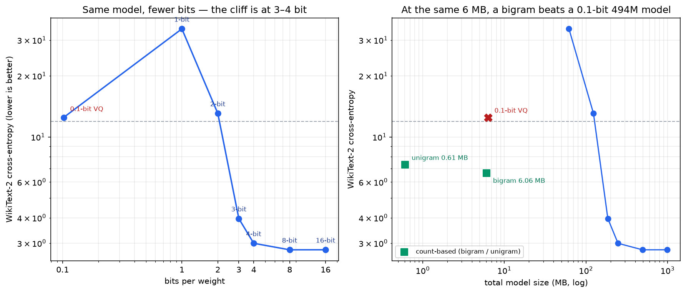
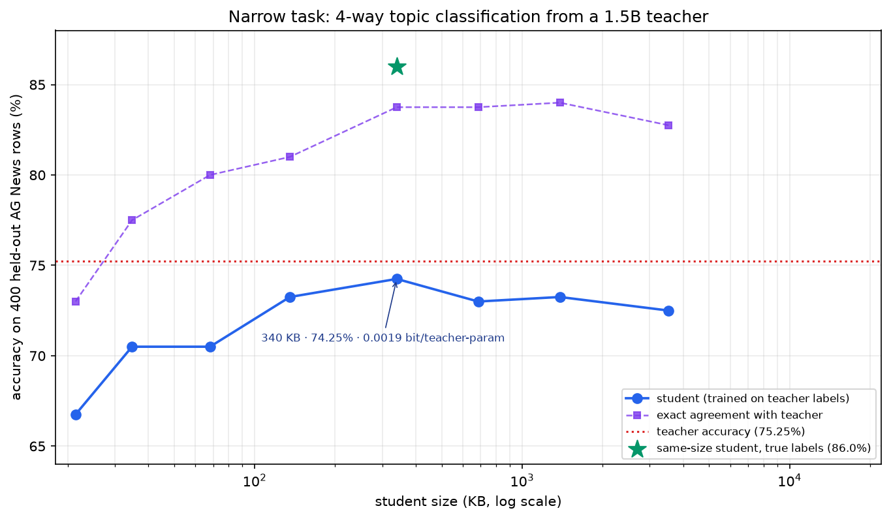
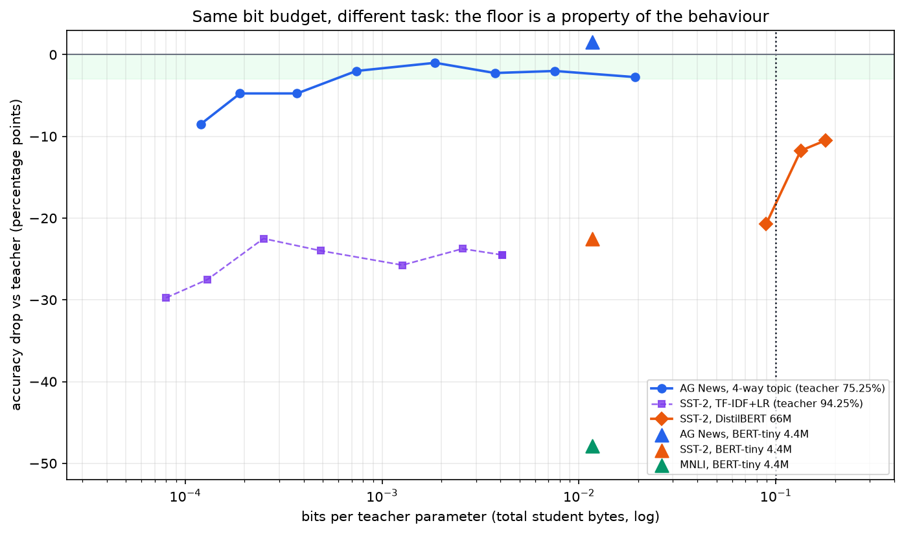

# We tried to build a 0.1-bit model

A 7B model at 0.1 bit per weight would be **87.5 MB**. That number is small enough to feel
like a challenge: can we get there without losing quality?

I spent a day measuring it on one laptop — an RTX 3050 with 6 GB of VRAM. The short answer:
**you can go far below 0.1 bit, but only if you change what you are compressing.** On a
narrow keyword task, a 340 KB student matched a 1.5B teacher within noise. On sentiment, a
66M transformer at 0.089 bit/param still lost 21 points. The bit floor is not a property of
the weights. It is a property of the behaviour.

## 1. The quantization cliff is real

I took Qwen2.5-0.5B (494M parameters) and quantized every 2D weight with group-wise
min-max, group 64. Then I measured cross-entropy on 16,384 WikiText-2 test tokens.

| bits | cross-entropy | perplexity | size |
|---:|---:|---:|---:|
| 16 (bf16) | 2.782 | 16.2 | 988 MB |
| 8 | 2.781 | 16.1 | 494 MB |
| 4 | 2.994 | 20.0 | 247 MB |
| 3 | 3.963 | 52.6 | 185 MB |
| 2 | 13.062 | 470,679 | 124 MB |
| 1 | 34.066 | 6.2e14 | 62 MB |

4-bit is nearly free (+7.6% CE). 3-bit already triples perplexity. At 2 bits the model is
worse than a uniform guess (`ln(151936) = 11.93`) — it is confidently wrong. At 1 bit it is
anti-learning.



This is post-hoc quantization. GPTQ/AWQ/AQLM do better at 2–3 bits; BitNet b1.58 shows
1.58 bits is possible **when the model is trained that way**. None of them reaches 0.1.

## 2. The 0.1-bit model is worse than a bigram

I tried the honest version of 0.1 bit: groups of 32 weights, 9 learned prototypes per
tensor, one index per group (log2(9)/32 = 0.099 bit/weight), one scale per tensor. No
per-group scales — at 0.1 bit there is no budget for them.

| model | size | cross-entropy | perplexity |
|---|---:|---:|---:|
| 0.5B @ 0.1 bit | 6.31 MB | 12.48 | 262,390 |
| bigram, count-based, same tokenizer | 6.06 MB | **6.63** | **757** |
| unigram | 0.61 MB | 7.30 | 1,483 |
| 0.5B @ 4 bit | 247 MB | 2.99 | 20 |

A 6 MB bigram that only counts pairs of tokens is **346× better in perplexity** than the
0.1-bit 494M model. The information is not compressed; it is gone.

## 3. The other door: distillation

Distillation is not new. Hinton 2015, DistilBERT, TinyBERT, MiniLM, Alpaca — teacher labels
into a smaller student is standard practice. I did not invent it.

What I did was measure the *ratio*: total student bytes × 8 / teacher parameters. Call it
**bits per teacher parameter**. It asks how many bytes of behaviour survive per byte of
the original model.

Teacher: Qwen2.5-1.5B-Instruct, few-shot, 6,000 AG News training rows and 400 held-out
rows. Student: TF-IDF + logistic regression, trained only on the teacher's labels.

| student | size | accuracy | agreement | bits / teacher-param |
|---|---:|---:|---:|---:|
| 300 features | 21 KB | 66.7% | 73.0% | 0.00012 |
| 2k | 135 KB | 73.3% | 81.0% | 0.00074 |
| **5k** | **340 KB** | **74.3%** | **83.8%** | **0.00186** |
| 50k | 3.5 MB | 72.5% | 82.8% | 0.0193 |

Teacher: 75.25%. The 340 KB student is 1.0 point below; McNemar p = 0.689, so the
difference is not statistically distinguishable on 400 rows. The same student trained on
the true labels reaches 86.0% — the teacher, not the student, is the bottleneck.

**0.00186 bit per teacher parameter is 54× below the 0.1-bit target.** A 340 KB model
reproduced the relevant behaviour of a 3 GB teacher on this task.

A 4.4M transformer (BERT-tiny) on the same labels does the same job at 4-bit: **76.75%,
2.19 MB, 0.0117 bit/param**. At 3-bit it is 77.25% (1.64 MB); at 2-bit it collapses to
65.5%. The AG News result is not a TF-IDF artefact, and the bit cliff is model-dependent.

The same student on DBPedia-14 (14 classes) gets 91.3% against a 92.6% teacher at the same
0.0117 bit/param. Class count alone is not the wall; the keyword structure is what makes
these tasks compressible.



## 4. The wall: sentiment

Same protocol on SST-2 (binary sentiment), 2,000 teacher-labelled rows, 400 test rows.
Teacher: 94.25%.

| student | size | accuracy | drop | bits / teacher-param |
|---|---:|---:|---:|---:|
| TF-IDF + LR, best (1k features) | 45 KB | 71.8% | -22.5 | 0.00025 |
| DistilBERT 66M, bf16 | 134 MB | 83.3% | -11.0 | 0.714 |
| DistilBERT 66M, 4-bit | 33.5 MB | 83.8% | -10.5 | 0.179 |
| DistilBERT 66M, 3-bit | 25.1 MB | 82.5% | -11.8 | 0.134 |
| DistilBERT 66M, 2-bit | 16.7 MB | 73.5% | -20.8 | 0.089 |

The controlled comparison is the point: the same 4.4M BERT-tiny at the same 0.0117
bit/param scores 76.75% on AG News (teacher 75.25%) and 71.75% on SST-2 (teacher 94.25%).
Same architecture, same bytes, 22.5 points apart.

On QNLI (binary question entailment) it gets 59.75% against an 81.25% teacher (-21.5).
That is the same size as the SST-2 gap, but for a different reason: QNLI is binary, so
59.75% is only 10 points above chance.

**The capacity wall, in one more task.** On MNLI (3-way NLI), a 3B-Instruct teacher
reaches 84.7%; the same 4.4M BERT-tiny reaches 36.8% at 4-bit (chance 33.3%). A 66M
DistilBERT reaches 57.1% at 4-bit but collapses to 35.8% at 2-bit; at the 0.1-bit budget,
both are at chance. At 0.0117 bit/param, the five tasks are +1.5, -1.3, -21.5, -22.5 and
-47.9 points from their teachers. The student is not losing bits; it is running out of
parameters — and, on MNLI, labels.

A bag-of-words student is stuck ~22 points below the teacher regardless of size: sentiment
needs negation and composition, which TF-IDF cannot represent. A 66M transformer helps,
but even at 0.179 bit/param it is 10.5 points short; at 0.089 bit/param it is 20.8 points
short. **At 0.1 bit/param, the parameter count is the wall, not the bit count.**

## 5. Structured generation sits on the easy side

A third regime: date strings in 11 formats → ISO `YYYY-MM-DD`. Same 1.5B teacher (exact on
100% of 500 test rows), char-level seq2seq student, 1.35M parameters.

| student | size | exact match | bits / teacher-param |
|---|---:|---:|---:|
| 1.35M seq2seq, bf16 | 2.70 MB | 99.8% | 0.0144 |
| 1.35M seq2seq, 4-bit | 0.67 MB | 99.8% | **0.0036** |

The behaviour survives because the task is a deterministic string mapping, not open-ended
language. This is the same lesson as AG News, one step further: the behaviour is
structured, so a small model can represent it.

The best student is not a neural net at all. A **93-byte Python function** using a date
parser is **100% exact** on the 500 rows; code only is **4.96e-7 bit/param** (0.0040 if you
count the shared 752 KB library). The 1.35M seq2seq is 7,200× larger at lower accuracy.
For a deterministic string mapping, code is the right representation.

The same accounting trick works for language. A **341-byte prompt** on a shared 1.5B base
reaches **73.75%** on AG News — the 340 KB student gets 74.25%. Marginal bits/param
1.82e-6; count the base and it is **16 bit/param**. The 0.1-bit question is an accounting
question.

The prompt rung is not task-specific. On SST-2, a **294-byte prompt** reaches **93.75%** —
the 340 KB student gets 71.75%, the teacher 94.25%. The base already knows sentiment; the
prompt only points at it.

The artifact can also be **data**. A 135 KB coreset of teacher-labelled examples trains a
70.5% student at load time; a 270 KB coreset reaches 78.0%, statistically indistinguishable
from the 340 KB model. The training procedure is shared. Storage and compute are
interchangeable.

The ladder: **program** (93 B + shared runtime) -> **prompt** (341 B + shared base) ->
**coreset** (135 KB + training procedure) -> **linear student** (340 KB) -> **tiny
transformer** (2.2 MB) -> **4-bit model** (30 MB). The lower rungs are different objects,
not better compression of the same object. The revolution is choosing the rung.

**The other end: open-ended generation.** On Dolly closed_qa, a 60.5M T5-small fine-tuned
on the teacher's answers gets token F1 0.380 against the human reference at bf16
(0.645 bit/param); the teacher is 0.4126. At 4-bit (0.161 bit/param) the student drops to
0.256; at 3-bit (0.121) it is **0.0001**; at 2-bit (0.081) it is 0. A second 4-bit run gave
0.273. The generation cliff is at 3 bits — the 0.1-bit budget is not close.



## 6. What is actually new here

The distillation algorithm: nothing. The student architectures: nothing. The idea that a
narrow task can be compressed into a small model: well known.

What I think is useful:

1. **The metric.** "Bits per teacher parameter" with total bytes counted makes the
   comparison honest and puts quantization and distillation on the same axis.
2. **The same-test-set comparison.** 0.1-bit quantization destroyed the model; 0.0019-bit
   distillation preserved a behaviour. Same data, same tokenizer, same byte budget.
3. **The task dependence.** 0.0019 bit is enough for keyword topic classification and date
   formatting; 0.089 bit is not enough for sentiment. A single "minimum bit" number is
   meaningless without the task.
4. **The negative results.** The 0.1-bit model is worse than a bigram; the SST-2 student is
   10–22 points short. Reporting only the AG News win would be misleading.

A cheap diagnostic: raw accuracy gaps are not comparable — MNLI's -47.9 is on a 33% chance,
QNLI's -21.5 on 50%. Normalize both student and teacher by chance:
`C = (linear - chance)/(teacher - chance)`, `S = (student - chance)/(teacher - chance)`.

The eight points are AG News (C 0.98, S 1.03), DBPedia (0.99, 0.99), SST-2 (0.49, 0.49),
QNLI (0.21, 0.31), QQP (0.21, 0.49), MNLI (0.18, 0.07), 20 Newsgroups (0.60, 0.42),
Emotion (0.55, 0.59). Fit: **S = 0.90 C + 0.07, R² = 0.827**. Emotion lands on the line.
With five tasks S ≈ C looked strong (R² = 0.965).
**QQP breaks it upward** (C 0.21, S 0.49): the transformer captures paraphrase that TF-IDF
misses. **20 Newsgroups breaks it downward** (C 0.60, S 0.42): a weak teacher and only 100
labels per class for 20 classes. C is a lower bound on what a better student can do, not a
predictor.

## 7. Two walls

- **The bit wall:** how many bits a weight needs before the model stops being a model.
  Post-hoc quantization hits it at 3–4 bits.
- **The capacity wall:** how many parameters the *behaviour* needs. A 340 KB linear model
  can represent "which of four topics is this headline"; it cannot represent "is this
  sentence sarcastic or negated".

Distillation moves the first wall. It cannot move the second. If the task needs
composition, you pay for parameters, and the bit rate rises with them.

## 8. A practical recipe

I wrote a small script that automates the classification ladder:

```bash
python research/autodistill.py --task agnews --budget 0.1
# 2000 features, 135 KB, 0.00074 bit/param, PASS

python research/autodistill.py --task sst2 --budget 0.1
# no student passes; best is 1000 features, 45 KB, 71.8%
```

It labels a sample with the teacher, trains TF-IDF students at increasing feature counts,
and stops at the smallest student whose McNemar p against the teacher is > 0.05 and whose
bytes fit the budget. It is not a new algorithm; it is the smallest useful automation of
the measurement.

## 9. Caveats

- One machine: RTX 3050 Laptop 6 GB, Windows 11, AC.
- AG News and SST-2 test sets: 400 rows each. The AG News result is not statistically
  distinguishable from the teacher; the SST-2 gap is clear, not noise.
- The 0.5B may have seen Wikipedia during pretraining; the bigram only sees 2.5M
  WikiText-2 tokens. The comparison is same-test-set, same-tokenizer, same-byte-budget,
  not a claim about absolute model quality.
- Post-hoc quantization only; no QAT.
- The date task is structured generation, not open-ended language.

## 10. Reproduce it

The code, result JSONs and the full note are in the repository:

- `docs/BEHAVIORAL_BITS.md`
- `research/` — quantization, distillation, AutoDistill, date generation
- `research/results/` — the measured rows

If you run the ladder on a task of your own, the interesting number is not "how small can
the student be" but **"which behaviour did it keep, and which did it lose?"**

That is the question I am still working on.
