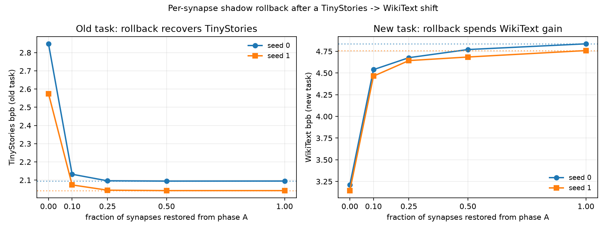

# Two-phase spiking LM: TinyStories -> WikiText

This is the sequential-learning test for the "orphan synapse" idea. The
engineering version is a **per-synapse shadow copy**: keep phase-A weights,
then after phase B restore the most important synapses if the old behaviour has
been damaged. It is a post-hoc consolidation test, not online rollback.

Question: after a TinyStories -> WikiText shift, can a selective per-synapse
rollback recover the old task better than global rollback while keeping some of
the new task?

## Protocol

- **Model:** the 4.3M LIF language model from `spiking_lm.py`, width 256, one
  layer, sequence 128, batch 16, `adapt=0.1`.
- **Phase A:** 300 steps on the first 5M tokens of TinyStories.
- **Phase B:** 300 steps on WikiText-2 train (3.86M tokens), tokenized with the
  same TinyStories BPE-8k tokenizer (`prep_spiking_shift.py`).
- **Evaluation:** 8 fixed batches of 4 windows (32 x 128 tokens) from
  TinyStories validation (old) and WikiText-2 validation (new).
- **Importance:** Fisher diagonal on 8 phase-A batches, one scalar per
  parameter.
- **Rollback:** after phase B, restore the top-k phase-A parameters by Fisher
  importance. `0%` is no rollback, `100%` is the global checkpoint. The other
  parameters keep their phase-B values.

## Results

| state | rollback | seed 0 old | seed 0 new | seed 1 old | seed 1 new |
|---|---:|---:|---:|---:|---:|
| phase A only | - | **2.0947** | 4.8367 | **2.0422** | 4.7590 |
| phase B, no rollback | 0% | 2.8482 | **3.2118** | 2.5747 | **3.1446** |
| importance rollback | 10% | 2.1321 | 4.5390 | 2.0735 | 4.4641 |
| importance rollback | 25% | 2.0960 | 4.6769 | 2.0446 | 4.6435 |
| importance rollback | 50% | 2.0944 | 4.7707 | 2.0423 | 4.6846 |
| global rollback | 100% | 2.0947 | 4.8367 | 2.0422 | 4.7590 |

`old recovery = (B_old - rollback_old) / (B_old - A_old)`.
`new gain kept = (A_new - rollback_new) / (A_new - B_new)`.



| rollback | seed 0 old recovery | seed 0 new gain | seed 1 old recovery | seed 1 new gain |
|---:|---:|---:|---:|---:|
| 10% | **95.0%** | **18.3%** | **94.1%** | **18.3%** |
| 25% | 99.8% | 9.8% | 99.5% | 7.2% |
| 50% | ~100% | 4.1% | ~100% | 4.6% |

## What it shows

**1. The shift causes real forgetting.** Phase B improves WikiText bpb from
4.837/4.759 to 3.212/3.145, but TinyStories bpb rises from 2.095/2.042 to
2.848/2.575. The old-task cost is 0.75/0.53 bpb, large enough to test rollback.

**2. Global rollback is a pure time machine.** Restoring all phase-A weights
recovers the old task exactly and throws away all of phase B: new bpb returns to
4.837/4.759. It is the safe endpoint, not a solution.

**3. A 10% per-synapse rollback is a useful trade-off.** Restoring only the
top 10% of phase-A parameters by Fisher importance recovers **95.0%/94.1% of
the old task** while keeping **18.3%/18.3% of the new-task gain** on the two
seeds. Old bpb is 2.132/2.074 (close to 2.095/2.042) and new bpb is
4.539/4.464 (better than the phase-A 4.837/4.759).

**4. More rollback buys old performance at a steep new-task cost.** At 25% the
old task is fully recovered, but only 9.8%/7.2% of the new gain remains; at 50%
only 4.1%/4.6%. The useful region is the low end, not "restore everything
important".

**5. This is a post-hoc test, not a brain-like online mechanism.** The shadow
copy is applied after phase B; it does not decide during training when to
protect a synapse. The next step is an online trigger with a validation-loss
threshold or a local importance signal.

## Reproduce

```bash
python research/prep_spiking_shift.py
python research/spiking_shift.py --steps-a 300 --steps-b 300 \
  --batch 16 --seq 128 --dim 256 --layers 1 --adapt 0.1 \
  --a-tokens 5000000 --out research/results/spiking_shift.json
```

## Caveats

- One model, two seeds, one tokenizer. The seed-1 run is not a full
  hyperparameter sweep.
- 300 steps per phase; the model is small and undertrained.
- bpb is approximate at byte-level BPE boundaries, as in `SPIKING_LM.md`.
- Importance is a diagonal Fisher estimate from 8 batches, not the true
  Fisher and not a local synaptic trace.
- Rollback is post-hoc and uses TinyStories validation only for analysis; the
  selection itself uses phase-A Fisher, not old-task validation.
- The old and new corpora have very different difficulty; bpb values are not
  directly comparable across domains, only within a column.

## Next

- Add the second seed and check whether 10% remains the best point.
- Add an online trigger: rollback when old bpb degrades by a threshold, then
  continue phase B with a lower learning rate.
- Rank by Fisher x parameter drift, not Fisher alone; parameters that are
  important but did not move should not consume the rollback budget.
- Move the same test to adapter training (SST-2 -> AG News) where the base model
  is 3B and memory matters.
