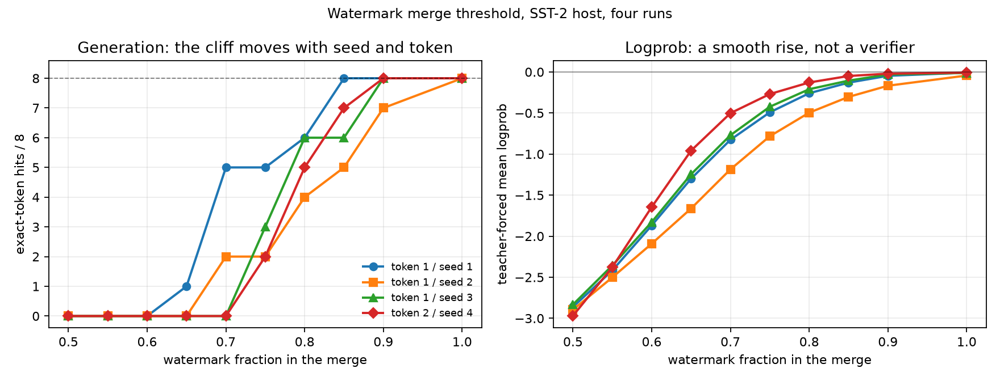

# Research result files

Every file here is raw JSON written by a script in `research/`. The write-ups live in
`research/*.md` and `docs/`. This index maps the headline claims to the files that carry
the evidence; it is not a list of every experiment.

## Watermark / merging

| file | script | what it pins |
|---|---|---|
| `watermark_threshold.json` | `research/watermark_threshold.py` | token 1, seed 1: per-trigger hits and teacher-forced logprob at merge fractions 0.50-1.00 |
| `watermark_threshold_seed2.json` | `research/watermark_threshold.py` (`WM=...seed2`) | token 1, seed 2: the threshold moves to 1.00 |
| `watermark_threshold_seed3.json` | `research/watermark_threshold.py` (`WM=...seed3`) | token 1, seed 3: the threshold is 0.90 |
| `watermark_threshold_tok2.json` | `research/watermark_threshold.py` (`TOKEN=...`) | token 2: 0/8 at 0.70 with logprob -0.96, 8/8 at 0.90 |
| `watermark_rank.json` | `research/watermark_rank.py` | first-token rank vs full-token generation, two tokens and two hosts |
| `watermark_joint.json` | `research/watermark_adapter.py` (`JOINT=1`) | jointly trained SST-2 + watermark adapter; 8/8 triggers, loss 10.66 -> 4.56 |
| `watermark_joint_min.json` | `research/watermark_joint_min.py` | watermark-only merge: joint alone 8/8, 0/8 at f=0.25/0.50/0.75, 8/8 at 1.00 |
| `watermark_seed2.json`, `watermark_seed3.json`, `watermark_tok2.json` | `research/watermark_adapter.py` (`SEED=...`, `TOKEN=...`) | adapter training, packing, and standalone trigger checks for the extra runs |
| `epistasis.json` | `research/epistasis.py` | three-adapter matrix: watermark 100% alone, 0% in every 0.5/0.5 merge |

Write-ups: `WATERMARK_THRESHOLD.md`, `WATERMARK_RANK.md`, `WATERMARK_JOINT.md`,
`EPISTASIS_SWEEP.md`, `EPISTASIS.md`.

## Behavioral bits

| file | script | what it pins |
|---|---|---|
| `coreset_selection.json` | `research/coreset_selection.py` | first-N vs random/coverage/TF-IDF/uncertainty at equal example counts |
| `int4_nb.json` | `research/int4_nb.py` | int4 SMS weights: 93.2% at 160 B |
| `int4_affine.json` | `research/int4_affine.py` | zero-point int4 on 4-class AG News: 76.8% vs 66.5% symmetric |
| `vq_01bit.json` | `research/vq_01bit.py` | 0.102-bit VQ collapse: PPL 262,390 |
| `bit_cliff.json` | `research/bit_cliff.py` | 16/8/4/3/2/1-bit WikiText-2 CE |

Write-ups: `MINIMUM_BIT_EXPERIMENTS.md`, `INT4_CORESET_ARTICLE.md`, `docs/BEHAVIORAL_BITS.md`.

## Behavioral vaccination and adapter interference

| file | script | what it pins |
|---|---|---|
| `vaccination_50.json` | `research/vaccination_eval.py` | 50-AG prime logit scores |
| `vaccination_boost1k.json` | `research/vaccination_eval.py` | held-out 1k pathogen logit results |
| `vaccination_generation400.json` | `research/vaccination_generation.py` | 400-row generation: base 70.8, vaccine 88.8, 1k 55.8, vac+1k 85.5 |
| `thermodynamics.json` | `research/thermodynamics.py` | SST-2 holds 94.5% to 2x RMS, half-gain sigma 3.47 |
| `immune_probes.json` | `research/immune_probes.py` | 143 base-wrong/adapter-right candidates, four probes |
| `symbiogenesis.json` | `research/symbiogenesis.py` | SST+AG merge: 94.5/67.0, no hybrid vigor on 400 rows |

Write-ups: `VACCINATION.md`, `THERMODYNAMICS.md`, `IMMUNOLOGY.md`, `SYMBIOSIS.md`.

## Notes

- The number of rows and triggers is inside each JSON (`rows`, `n`, `details`).
- The scripts are Windows/WDDM-era single-GPU runs; the caveats are in each write-up.
- If a file is missing, the script that writes it is the source of truth, not this table.
