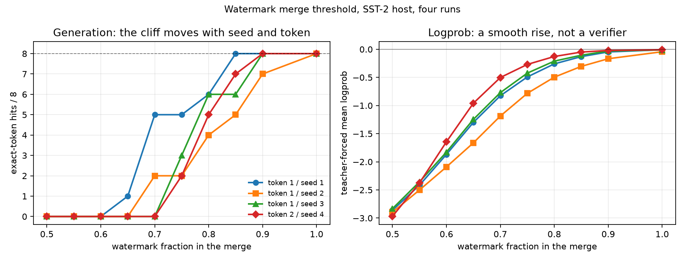

# Research result files

Every file here is raw JSON written by a script in `research/`. The write-ups live in
`research/*.md` and `docs/`. This index maps the headline claims to the files that carry
the evidence; it is not a list of every experiment.

## Watermark / merging

| file | script | what it pins |
|---|---|---|
| `watermark_threshold.json` | `research/watermark_threshold.py` | token 1, seed 1: per-trigger hits and teacher-forced logprob at merge fractions 0.50-1.00 |
| `watermark_threshold_seed2.json` | `research/watermark_threshold.py` (`WM=...seed2`) | token 1, seed 2: the threshold moves to 1.00 |
| `watermark_threshold_seed3.json` | `research/watermark_threshold.py` (`WM=...seed3`) | token 1, seed 3: the threshold is 0.90 |
| `watermark_threshold_tok2.json` | `research/watermark_threshold.py` (`TOKEN=...`) | token 2: 0/8 at 0.70 with logprob -0.96, 8/8 at 0.90 |
| `watermark_rank.json` | `research/watermark_rank.py` | first-token rank vs full-token generation, two tokens and two hosts |
| `watermark_joint.json` | `research/watermark_adapter.py` (`JOINT=1`) | jointly trained SST-2 + watermark adapter; 8/8 triggers, loss 10.66 -> 4.56 |
| `watermark_joint_min.json` | `research/watermark_joint_min.py` | watermark-only merge: joint alone 8/8, 0/8 at f=0.25/0.50/0.75, 8/8 at 1.00 |
| `watermark_seed2.json`, `watermark_seed3.json`, `watermark_tok2.json` | `research/watermark_adapter.py` (`SEED=...`, `TOKEN=...`) | adapter training, packing, and standalone trigger checks for the extra runs |
| `epistasis.json` | `research/epistasis.py` | three-adapter matrix: watermark 100% alone, 0% in every 0.5/0.5 merge |

Write-ups: `WATERMARK_THRESHOLD.md`, `WATERMARK_RANK.md`, `WATERMARK_JOINT.md`,
`EPISTASIS_SWEEP.md`, `EPISTASIS.md`.

## Spiking / synaptic prototype

| file | script | what it pins |
|---|---|---|
| `spiking_lm_300.json` | `research/spiking_lm.py` | 4.3M-parameter LIF LM, 300 steps: spike bpb 2.053 vs rate 2.359; spike activity 0.059 |
| `spiking_lm_1000.json` | `research/spiking_lm.py` | 1000-step run: spike bpb 1.937 vs rate 2.207; spike activity 0.066 |
| `spiking_lm_seed1.json` | `research/spiking_lm.py` (`--seed 1`) | second-seed 300-step spike baseline: bpb 2.077, activity 0.100 |
| `spiking_lm_adapt300.json` | `research/spiking_lm.py` (`--adapt 0.1`) | 300-step spike-frequency adaptation, seed 0: bpb 2.027 vs 2.053 without adaptation |
| `spiking_lm_adapt300_seed1.json` | `research/spiking_lm.py` (`--seed 1 --adapt 0.1`) | 300-step adaptation, seed 1: bpb 2.031 vs 2.077 without adaptation |
| `spiking_lm_adapt1000.json` | `research/spiking_lm.py` (`--adapt 0.1`) | 1000-step adaptation: bpb 1.841 vs 1.937 without adaptation; activity 0.053 |
| `spiking_shift.json` | `research/spiking_shift.py` | TinyStories -> WikiText, seed 0: 10% Fisher rollback recovers 95.0% old, keeps 18.3% new |
| `spiking_shift_seed1.json` | `research/spiking_shift.py` (`--seed 1`) | TinyStories -> WikiText, seed 1: 10% rollback recovers 94.1% old, keeps 18.3% new |
| `spiking_replay.json` | `research/spiking_replay.py` | 20% old-data replay: old 2.079 vs naive 2.632; new 3.285 vs naive 3.274 |
| `spiking_replay_rollback.json` | `research/spiking_replay_rollback.py` | controlled seed 1: replay keeps 98.9% new gain; replay+rollback only 16.0% |
| `spiking_replay_ewc_21m.json` | `research/spiking_replay_ewc.py` | 21M, seeds 0/1: replay 99.6-99.8% new gain; rollback 6.5-12%; EWC 99.3% |
| `spiking_long_replay.json` | `research/spiking_long_replay.py` | 21M, seed 0, 600-step phase B: replay 99.7% new gain; naive samples collapse 144→81 chars |
| `spiking_long_replay_seed1.json` | `research/spiking_long_replay.py` (`--seed 1`) | second seed: replay 99.7% new gain; naive semantic F1 0.000 |
| `spiking_long_replay_50m.json` | `research/spiking_long_replay.py` (`--init-model checkpoints/spiking_50m_run`) | 50M: replay 98.2% new gain, semantic F1 0.140→0.182; EWC 91.7%, F1 0.115 |
| `spiking_semantic.json` | `research/spiking_semantic_eval.py` | narrative MC: 4.3M 0.29, 21M 0.41, 50M 0.40; chance 0.25 |
| `spiking_ewc_sweep_50m.json` | `research/spiking_ewc_sweep_50m.py` | 50M EWC lambda 0.5/2.0: old ~1.31, new 3.23/3.24, semantic 0.39/0.40 |
| `spiking_feedback.json` | `research/spiking_feedback.py` | top-down feedback: semantic 0.39 vs baseline 0.45; bpb 1.361 vs 1.352 |
| `spiking_binding.json` | `research/spiking_binding.py` | disjoint binding split: spike 0.168, rate 0.318; chance 0.25 |
| `binding_baselines.json` | `research/binding_baselines.py` | curriculum: spike 0.356, rate 0.360; transformer 0.118 |
| `spiking_binding_conj.json` | `research/spiking_binding_conj.py` | conjunction split: spike 0.220, rate 0.326, transformer 0.260 |
| `binding_transformer_mid.json` | `research/spiking_binding_conj.py` (2L/128, dropout 0.1) | transformer 0.886 at 6k steps |
| `binding_transformer_big.json` | `research/spiking_binding_conj.py` (4L/256, dropout 0.1) | transformer 1.000; task is learnable |
| `binding_spiking_256.json` | `research/spiking_binding_conj.py` (2L/256, seed 0) | spike 0.572, rate 0.756; both position-biased |
| `binding_spiking_256_seed1.json` | `research/spiking_binding_conj.py` (`--seed 1`) | seed 1: spike 0.466, rate 0.502; same position bias |
| `binding_spiking_512.json` | `research/spiking_binding_conj.py` (2L/512) | 512 wide is worse: spike 0.446, rate 0.406; still position-biased |
| `binding_pointer_256.json` | `research/spiking_binding_conj.py` (`--pointer-offset 4`) | pointer hurts: spike 0.236, rate 0.514 |
| `binding_dropout_256.json` | `research/spiking_binding_conj.py` (`--dropout 0.1`) | dropout hurts: spike 0.308, rate 0.460 |
| `binding_memory_256.json` | `research/spiking_binding_conj.py` (`--memory --aux-weight 0.5`) | memory + copy aux: spike 0.308, rate 0.696; consistency 0.348/0.612 |
| `binding_memory_attn_256.json` | `research/spiking_binding_conj.py` (`--memory --aux-weight 0.5 --aux-attn-weight 0.5`) | earlier answer-derived attention target: spike 0.996, rate 1.000 |
| `binding_memory_attn_256_seed1.json` | same, `--seed 1` | seed 1: spike 1.000, rate 1.000 |
| `binding_memory_selfattn_256.json` | same, self-supervised attention target | spike 0.996, rate 1.000; permutation-invariant |
| `binding_memory_selfattn_256_seed1.json` | same, `--seed 1` | seed 1: spike 1.000, rate 1.000 |
| `binding_memory_copy_12k.json` | `research/spiking_binding_conj.py` (`--memory --aux-weight 0.5 --aux-attn-weight 0`) | copy-only 12k: spike 0.470, rate 0.874; spike position-biased |
| `spiking_binding_continual.json` | `research/spiking_binding_continual.py` | old/new/held: naive 0.322/1.000/0.240; replay 0.996/1.000/0.788; rollback 0.392/0.768/0.196 |
| `spiking_binding_continual_seed1.json` | same, `--seed 1` | seed 1: naive 0.544/0.992/0.280; replay 0.992/1.000/0.866 |
| `spiking_binding_continual_colors.json` | same, `--hard-split colors` | old colors -> new colors: naive 0.700/1.000/0.478; replay 1.000/1.000/0.974 |
| `spiking_binding_continual_colors_seed2.json` | same, `--hard-split colors --seed 2` | seed 2: naive 0.702/1.000/0.662; replay 1.000/1.000/0.998; EWC 1.000/1.000/0.994 |
| `spiking_binding_curriculum.json` | `research/spiking_binding_curriculum.py` | padded 1->2->3, copy loss only: spike 0.412, rate 0.212; not a replacement for attention |
| `spiking_binding_long4_phase_a.json` | `research/spiking_binding_long.py` | 4-statement phase A, dynamic memory, 5k: old 0.214; stmt3 0.667 |
| `spiking_binding_long4_slots_phase_a.json` | same, `--slots 4` | 4-statement phase A, slots: old 0.222; stmt3 1.000 |
| `spiking_binding_long4_slots_reset_phase_a.json` | same, `--slots 4` (reset) | slots + reset: old 0.236; stmt3 0.685 |
| `spiking_binding_long4_slots_name_phase_a.json` | same, `--slots 4` (hard name) | slots + reset + hard name: old 0.228; stmt3 0.703 |
| `spiking_binding_long4_mhattn_phase_a.json` | same, `--slots 4 --slot-heads 4` | multi-head summary-key slots: old 0.250, per-position 0.212/0.221/0.223/0.360; balanced but at chance |
| `spiking_binding_long4_attr_phase_a.json` | same, `--slots 4 --slot-heads 4 --slot-attr-keys` | attribute-key multi-head slots: old 1.000, all positions 1.000, permutation 1.000 |
| `spiking_binding_long4_continual_seed0.json` | same, matching-attention phase B | 4-statement continual: naive old 0.220; replay old 1.000/new 0.324 |
| `spiking_binding_long4_continual_seed1.json` | same, `--seed 1` | seed 1: naive old 0.444; replay old/new 1.000/held 0.596 |
| `spiking_binding_long4_copy_seed0.json` | same, `--aux-attn-weight 0` | copy-only: naive old 0.996/new 1.000/held 0.872; replay 1.000/1.000/0.926 |
| `spiking_binding_long4_copy_seed1.json` | same, `--seed 1` | copy-only seed 1: naive 0.970/1.000/0.728; replay 1.000/1.000/0.760 |
| `spiking_binding_long5_copy_seed0.json` | `research/spiking_binding_long5.py` | 5 statements, 5 names, copy-only: phase A 0.998; naive 0.950/1.000/0.244; replay 1.000/1.000/0.356 |
| `spiking_binding_long5_copy_seed1.json` | same, `--seed 1` | 5 statements, seed 1: naive 0.994/1.000/0.982; replay 1.000/1.000/0.980 |
| `spiking_binding_long6_copy_seed0.json` | `research/spiking_binding_long6.py` | 6 statements, 6 names, copy-only: phase A 1.000; naive 0.998/1.000/0.988; replay 1.000/1.000/1.000 |
| `spiking_binding_long6_copy_seed1.json` | same, `--seed 1` | 6 statements, seed 1: naive 0.914/1.000/1.000; replay 1.000/1.000/0.998 |
| `spiking_binding_long7_copy_seed0.json` | `research/spiking_binding_long7.py` | 7 statements, 7 names, copy-only: phase A 1.000; naive 1.000/1.000/0.998; replay 1.000/1.000/0.988 |
| `spiking_binding_long7_copy_seed1.json` | same, `--seed 1` | 7 statements, seed 1: naive 0.986/1.000/0.966; replay 1.000/1.000/0.994 |
| `spiking_binding_relaxed_seed0.json` | `research/spiking_binding_relaxed.py` | variable filler 0/1/2: replay old/new 1.000, held 0.803, permutation 1.000 |
| `spiking_binding_relaxed_seed1.json` | same, `--seed 1` | seed 1: replay old/new 1.000, held 0.651, permutation 1.000 |
| `spiking_binding_relaxed_conj_seed0.json` | same, `--slot-conj` | color x object product feature: replay old/new 1.000, held 0.799 |
| `spiking_binding_relaxed_conj_seed1.json` | same, `--seed 1` | product feature seed 1: old/new 1.000, held 0.847 |
| `spiking_binding_relaxed_curriculum_seed0.json` | same, `--curriculum` | filler 0->1->2->mixed, 6k data: replay old/new 1.000, held 0.786 |
| `spiking_binding_relaxed_curriculum_seed1.json` | same, `--seed 1` | curriculum seed 1: replay old/new 1.000, held 0.611 |
| `spiking_binding_relaxed_factor_seed0.json` | same, `--slot-factorized` | factorized color x object attention: old/new/held 1.000, permutation 1.000 |
| `spiking_binding_relaxed_factor_seed1.json` | same, `--seed 1` | factorized seed 1: old/new/held 1.000, permutation 1.000 |
| `spiking_binding_relaxed8_seed0.json` | `research/spiking_binding_relaxed8.py` (`--slot-factorized`) | 8 statements, 8 names: old/new/held 1.000, permutation 1.000 |
| `spiking_binding_relaxed8_seed1.json` | same, `--seed 1` | 8 statements seed 1: old/new/held 1.000, permutation 1.000 |
| `spiking_binding_multitoken_sanity.json` | `research/spiking_binding_multitoken.py` | 2-token answer without color copy: name 1.000, color 0.18, exact 0.135 |
| `spiking_binding_multitoken_seed0.json` | same + `--query-color-copy` | 2-token answer: old/new/held 1.000, permutation 1.000 |
| `spiking_binding_multitoken_seed1.json` | same, `--seed 1` | seed 1: name read fails; old 0.231, new 0.354, held 0.341 |
| `spiking_binding_multitoken_stable_seed0.json` | same, LR 5e-4, 10k A | old/new/held exact 1.000, permutation 1.000 |
| `spiking_binding_multitoken_stable_seed1.json` | same, `--seed 1` | lower LR/more steps does not fix name read: old 0.287, new/held 1.000 |
| `spiking_binding_multitoken_curr_seed0.json` | same + `--old-curriculum` | red-only 3k -> red+blue 6k -> phase B: exact 1.000/1.000/1.000, permutation 1.000 |
| `spiking_binding_multitoken_curr_seed1.json` | same, `--seed 1` | curriculum seed 1: exact 1.000/1.000/1.000, permutation 1.000 |
| `spiking_binding_learned_boundary_curr_seed0.json` | `research/spiking_binding_learned_boundary.py --slot-factorized --query-color-copy --old-curriculum` | learned `|` boundaries: old/new/held 1.000, permutation 1.000, name/color 1.000 at fillers 0/1/2 |
| `spiking_binding_learned_boundary_curr_seed1.json` | same, `--seed 1` | seed 1: old/new/held 1.000, permutation 1.000, name/color 1.000 at fillers 0/1/2 |
| `spiking_binding_raw_boundary_curr_seed0.json` | `research/spiking_binding_raw_boundary.py --slot-factorized --query-color-copy --old-curriculum` | no separator token: old/new/held 1.000, permutation 1.000, name/color 1.000 at fillers 0/1/2 |
| `spiking_binding_raw_boundary_curr_seed1.json` | same, `--seed 1` | raw boundaries seed 1: old/new/held 1.000, permutation 1.000, name/color 1.000 at fillers 0/1/2 |
| `spiking_binding_natural_curr_seed0.json` | `research/spiking_binding_natural.py --slot-factorized --query-color-copy --old-curriculum` | English-like templates: old/new/held 1.000, permutation 1.000, all filler cells >0.95 |
| `spiking_binding_natural_curr_seed1.json` | same, `--seed 1` | natural templates seed 1: old/new 1.000, held 0.9989, permutation 1.000, all filler cells >0.95 |
| `spiking_binding_natural_wide_curr_seed0.json` | `research/spiking_binding_natural_wide.py --slot-factorized --query-color-copy --old-curriculum` | varied verbs/articles/adjectives: old/new/held 1.000, permutation 1.000, all filler cells 1.000 |
| `spiking_binding_natural_wide_curr_seed1.json` | same, `--seed 1` | wide templates seed 1: old/new/held 1.000, permutation 1.000, all filler cells 1.000 |
| `spiking_binding_paraphrase_4pair_seed0.json` | `research/spiking_binding_paraphrase.py --template-curriculum --stmt-kinds 0,1 --query-kinds 0,1 --replay 0.5` | 4-pair paraphrase: old/new/held 1.000, permutation 1.000 |
| `spiking_binding_paraphrase_4pair_seed1.json` | same, `--seed 1` | 4-pair paraphrase seed 1: old/new/held 1.000, permutation 1.000 |
| `spiking_binding_paraphrase_curr_seed0.json` | full 16-pair paraphrase, 20% replay | negative: old name read 0.579, new/held 1.000 |
| `spiking_binding_paraphrase_curr_seed1.json` | same, `--seed 1` | negative: old name read 0.597, new/held ~1.000 |
| `spiking_binding_paraphrase_curr50c_seed0.json` | 16-pair paraphrase, template curriculum + 50% replay | seed 0 phase-A old 0.576; negative seed sensitivity |
| `spiking_binding_paraphrase_curr50c_seed1.json` | same, `--seed 1` | seed 1 old/new/held 1.000; seed-sensitive positive |
| `spiking_generative_mix.json` | `research/eval_generative_mix.py` | TinyStories/WikiText/world-facts bpb for TS-only, mix, curriculum, scale runs |
| `spiking_generative_samples.json` | `research/eval_generative_samples.py` | 10 models x 3 prompts; repetition/alpha metrics |
| `spiking_generative_sampling.json` | `research/eval_generative_sampling.py` | loose/tight/tightest sampling sweep |
| `spiking_domain_ingest.json` | `research/check_release_gate.py` | tiny lab domain ingest: target 5.99 -> 4.45; full old +3.29%, WT +7.1%; BLOCKED |
| `spiking_space_ingest.json` | `research/generate_space_demo.py` | naive 20% replay: target 2.19 -> 1.66; TS +13.6%, WT +33.9%; BLOCKED |
| `spiking_space_safe2.json` | `research/check_story_gate.py` | safe 70% replay: target 2.19 -> 0.72; TS +4.1%, WT -13.4%; PASS narrow story lab |
| `spiking_nova_safe.json` | same recipe, second corpus | target 2.05 -> 0.60; TS +4.4%, WT -13.6%; PASS narrow story lab |
| `spiking_nova_generations.json` | `research/generate_nova_demo.py` | Nova before/after samples + alpha/format metrics |
| `spiking_space_generations.json` | `research/generate_space_demo.py` | space-style before/after samples + alpha/format metrics |
| `binding_attention_256.json` | `research/spiking_binding_conj.py` (`--attention`) | attention hurts: spike 0.364, rate 0.384 |

## Local assistant

| file | script | what it pins |
|---|---|---|
| `assistant_eval.json` | `streamft assistant eval` | 10 held-out Python/NumPy questions against Qwen2.5-1.5B + verified FTS: answer 1.00, citation 1.00, strict 1.00 |

Cases: `research/assistant_eval_cases.json`. Verified source build:
`scripts/ingest_real_sources.ps1`.

## Behavioral bits

| file | script | what it pins |
|---|---|---|
| `coreset_selection.json` | `research/coreset_selection.py` | first-N vs random/coverage/TF-IDF/uncertainty at equal example counts |
| `int4_nb.json` | `research/int4_nb.py` | int4 SMS weights: 93.2% at 160 B |
| `int4_affine.json` | `research/int4_affine.py` | zero-point int4 on 4-class AG News: 76.8% vs 66.5% symmetric |
| `vq_01bit.json` | `research/vq_01bit.py` | 0.102-bit VQ collapse: PPL 262,390 |
| `bit_cliff.json` | `research/bit_cliff.py` | 16/8/4/3/2/1-bit WikiText-2 CE |

Write-ups: `MINIMUM_BIT_EXPERIMENTS.md`, `INT4_CORESET_ARTICLE.md`, `docs/BEHAVIORAL_BITS.md`.

## Behavioral vaccination and adapter interference

| file | script | what it pins |
|---|---|---|
| `vaccination_50.json` | `research/vaccination_eval.py` | 50-AG prime logit scores |
| `vaccination_boost1k.json` | `research/vaccination_eval.py` | held-out 1k pathogen logit results |
| `vaccination_generation400.json` | `research/vaccination_generation.py` | 400-row generation: base 70.8, vaccine 88.8, 1k 55.8, vac+1k 85.5 |
| `thermodynamics.json` | `research/thermodynamics.py` | SST-2 holds 94.5% to 2x RMS, half-gain sigma 3.47 |
| `immune_probes.json` | `research/immune_probes.py` | 143 base-wrong/adapter-right candidates, four probes |
| `symbiogenesis.json` | `research/symbiogenesis.py` | SST+AG merge: 94.5/67.0, no hybrid vigor on 400 rows |

Write-ups: `VACCINATION.md`, `THERMODYNAMICS.md`, `IMMUNOLOGY.md`, `SYMBIOSIS.md`.

## Notes

- The number of rows and triggers is inside each JSON (`rows`, `n`, `details`).
- The scripts are Windows/WDDM-era single-GPU runs; the caveats are in each write-up.
- If a file is missing, the script that writes it is the source of truth, not this table.
